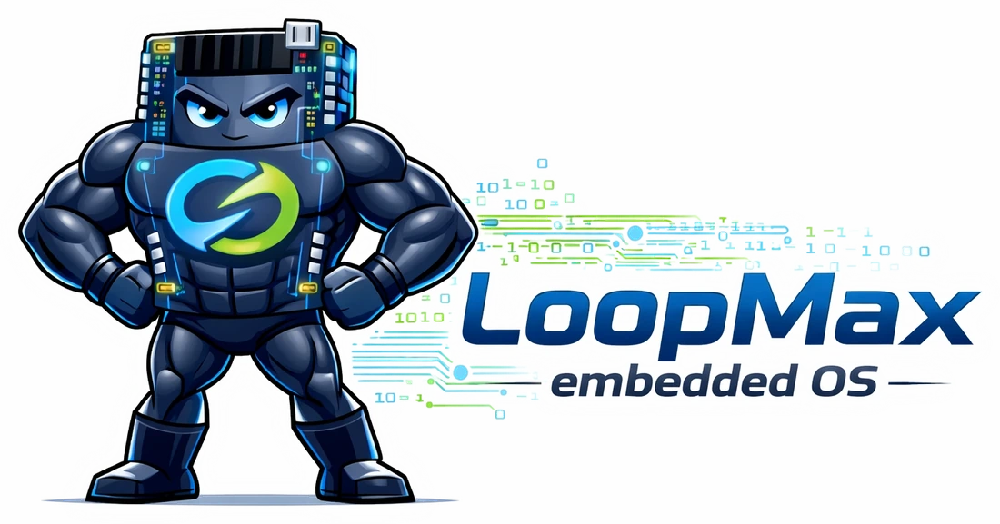
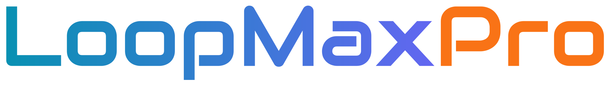
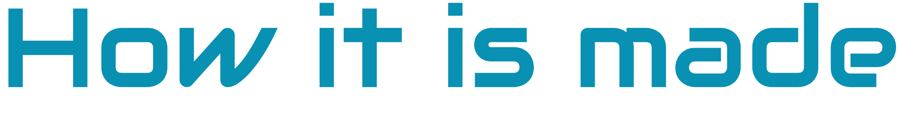
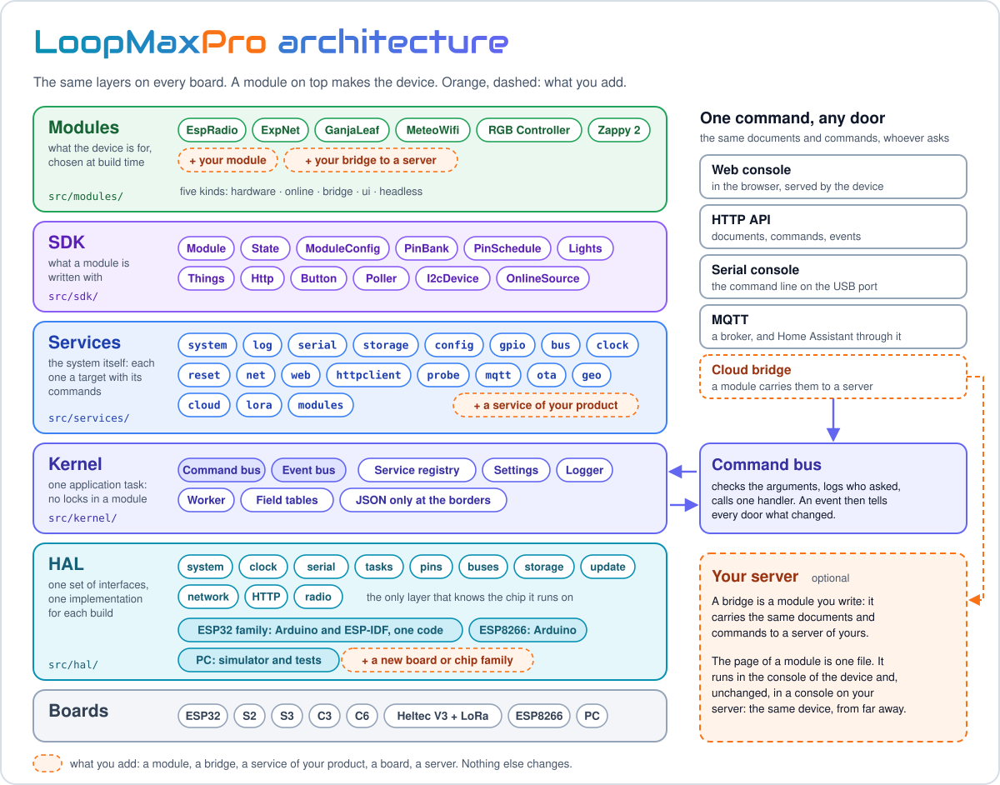
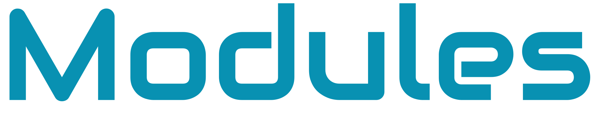
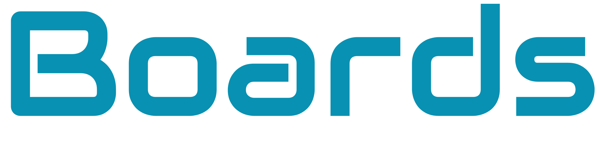
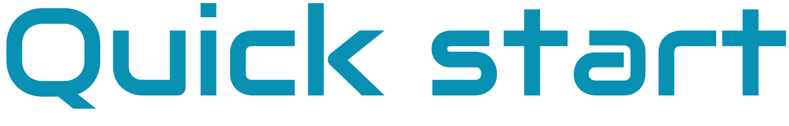
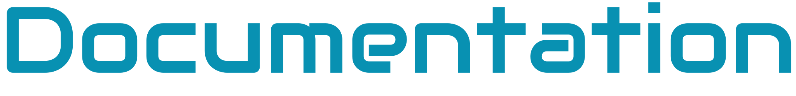
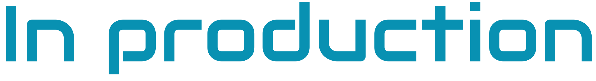
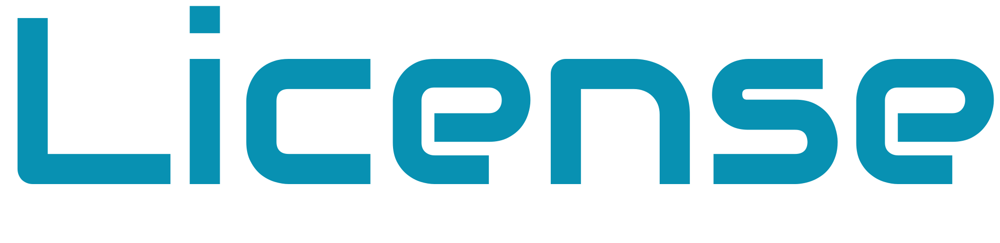

<p align="center"></p>

<p align="center">&nbsp;&nbsp;&nbsp;</p>

<p align="center"><em>One embedded OS, many boards, any module.</em><br>
System services, a web console and an SDK for Wi-Fi microcontrollers.</p>

<p align="center">
<a href="#highlights">Highlights</a> &nbsp;·&nbsp;
<a href="#modules">Modules</a> &nbsp;·&nbsp;
<a href="#boards">Boards</a> &nbsp;·&nbsp;
<a href="#quick-start">Quick start</a> &nbsp;·&nbsp;
<a href="docs/README.md">Documentation</a> &nbsp;·&nbsp;
<a href="https://smartilab.it/firmware/">Web flasher</a> &nbsp;·&nbsp;
<a href="#license">License</a>
</p>

---

<h2 id="what-it-is"></h2>

LoopMaxPro is a modular operating system for microcontrollers with Wi-Fi and storage. It brings
everything a connected device needs before its real job begins: network, settings, clock,
storage, logs, updates, a web console to manage and watch the device, and the ways to reach it
from outside. On top of it a **module** adds what the device is for: relays, a lamp, a weather
display, a network explorer.

**LoopMaxPro plus a module is a device.** You write the module; the system is already there,
the same on every board.

It is the complete re-engineering of LoopMax v1: the ideas that worked, on a new engine built
to run the same OS on as many boards as possible.

<h2 id="highlights"></h2>

| | |
|---|---|
| **One OS, many boards** | The ESP32 family (ESP32, S2, S3, C3, C6, with or without LoRa) and the ESP8266, from the same sources. On the ESP32 family the same code builds with Arduino and with ESP-IDF. |
| **Two editions** | The normal edition for the ESP32 family, a light edition for the boards with little memory. A module asks the system for its own values on a board without touching the OS. |
| **A console in the device** | A web app served by the board itself, made for the phone first, in English and Italian. No cloud and no app to install: open the address of the device. |
| **Modules that only say what they are** | A module declares its state, its settings and its commands. The system carries them to the console, to HTTP, to MQTT and to the serial port, and draws a standard page for them. A module can bring a page of its own in one file. |
| **Ready for the house** | Devices announce themselves on the network and find each other. With an MQTT broker they show up in Home Assistant by themselves. |
| **Native data, JSON at the borders** | Inside the engine the data are C++ structures in fixed memory; JSON exists only where the device talks to the outside. |
| **Developed on the PC** | The whole system runs on the PC as a simulator with its console in the browser, and more than 500 tests run there without a board. |
| **Open to a server of yours** | A cloud service waits for a bridge: a module can connect the device to any server, with one envelope for the data. Without one the device works fully on its own. |

<h2 id="how-it-is-made"></h2>

<p align="center">

</p>

Read it from the bottom. The **HAL** is the only layer that knows the chip: one set of interfaces
and one implementation for each build; on the ESP32 family the same code works with Arduino and
with ESP-IDF. The **kernel** and the **services** are the system, the same on every board. The **SDK** is what a module is written with,
and a **module** makes the device. Every way in, the web console, the HTTP API, the serial console,
MQTT, a cloud bridge, leads to one command bus: a module declares its state and its commands once and
is reachable from all of them. In orange, what you add.

More in [Architecture](docs/architecture.md), [Hardware abstraction layer](docs/hal.md) and
[Kernel and services](docs/kernel-and-services.md).

<h2 id="modules"></h2>

The free modules of this repository. Each one has its page, with hardware, build and use.

| Module | What it is |
|--------|------------|
| [EspRadio](src/modules/espradio/README.md) | A web radio in the page of the device: stations, favourites, looks to choose from |
| [ExpNet](src/modules/expnet/README.md) | Networks Explorer: the devices of your home network, watched services, alerts |
| [GanjaLeaf](src/modules/ganjaleaf/README.md) | A lamp in the shape of a leaf: an RGB strip and a ring of LEDs |
| [MeteoWifi](src/modules/meteowifi/README.md) | The weather of your town, in the console and on a small display |
| [RGB Controller](src/modules/rgb/README.md) | An analog RGB LED strip with colours, effects and schedules |
| [Zappy 2](src/modules/zappy2/README.md) | Two relays with schedules |

Each of them can be installed from the browser, without a build, with the
[web flasher](https://smartilab.it/firmware/) of SmartiLab: choose the firmware and a compatible
board.

To write your own, start from [Modules and SDK](docs/modules-sdk.md) and
[Writing a module](docs/writing-a-module.md).

<h2 id="boards"></h2>

| Family | Boards | Edition |
|--------|--------|---------|
| ESP32 | ESP32, ESP32-S2, ESP32-S3, ESP32-C3, ESP32-C6, Heltec WiFi LoRa 32 V3 | normal |
| ESP8266 | NodeMCU, Heltec WiFi Kit 8 | light |
| PC | the simulator and the tests | normal |

The environments, what each board has and how to choose one are in [Boards](docs/boards.md).

<h2 id="quick-start"></h2>

**Without a build:** the [web flasher](https://smartilab.it/firmware/) of SmartiLab installs a
ready firmware from the browser: choose the firmware and a compatible board.

**From the sources** you need [PlatformIO](https://platformio.org/) and, for the PC build, a C++
compiler.

```
pio run -e native                the simulator on the PC: run it, then open http://localhost:8088
pio test -e native               the tests, on the PC
pio run -e rgb_c3 -t upload      a ready product: RGB Controller on an ESP32-C3
```

A new board starts as an access point named `LoopMax-XXXX`, password `loopmaxap`: join it and
open `http://192.168.4.1/`. Everything else is in [Build and flash](docs/build.md).

<h2 id="documentation"></h2>

| Start here | Inside the system | Around the device |
|------------|-------------------|-------------------|
| [Build and flash](docs/build.md) | [Architecture](docs/architecture.md) | [Web console](docs/web-console.md) |
| [Boards](docs/boards.md) | [Hardware abstraction layer](docs/hal.md) | [HTTP API](docs/http-api.md) |
| [Modules and SDK](docs/modules-sdk.md) | [Kernel and services](docs/kernel-and-services.md) | [Serial console](docs/serial-console.md) |
| [Writing a module](docs/writing-a-module.md) | [Data model and report](docs/data-model.md) | [Discovery, MQTT and Home Assistant](docs/network-and-home-assistant.md) |
| [Versions and updates](docs/updates.md) | [Cloud bridge](docs/cloud.md) | [LoRa](docs/lora.md) |

The index is in [docs/](docs/README.md); what each version brings is in [CHANGES.md](CHANGES.md).

<h2 id="in-production"></h2>

LoopMaxPro is not a demo. It is the system inside the IoT devices of
[SmartiLab](https://smartilab.it): the same engine that is published here runs in products that
are sold and updated in the field. What you find in this repository is that engine with its free
modules.

<h2 id="license"></h2>

Free for **personal and hobby use only**: use it, change it, share it and publish your changes on
the same terms, saying where it comes from. **Commercial use is forbidden, in any form and in any
variant**, without a written license from SmartiLab. Read the [LICENSE](LICENSE).

The code of others keeps its own license: see [THIRD-PARTY.md](THIRD-PARTY.md).
