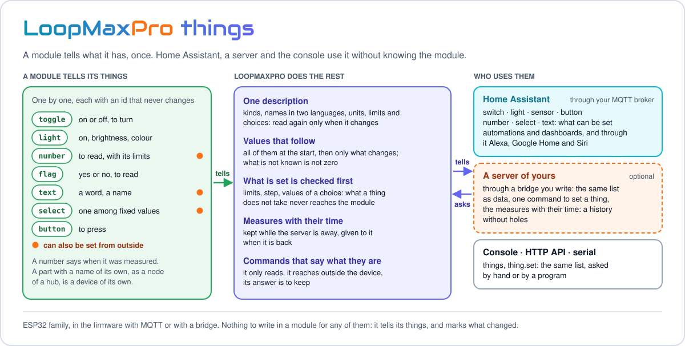

<p align="center"><a href="../README.md"></a>&nbsp;&nbsp;&nbsp;</p>

<p align="center">
<a href="../README.md">Home</a> &nbsp;·&nbsp;
<a href="README.md">Documentation</a> &nbsp;·&nbsp;
<a href="data-model.md">← Data model and report</a> &nbsp;·&nbsp;
<a href="writing-a-module.md">Writing a module →</a>
</p>

---

A module is the part that gives a device its purpose: LoopMaxPro is the operating system, and
LoopMaxPro plus one or more modules is a device. This page is the reference for anyone who reads
or writes a module: what a module is made of, the manifest `module.json` field by field, the C++
contract of the SDK, the ready-made parts, the system services a module uses, and how a module
asks for its own values of the OS on a given board. For a guided example from an empty folder,
see [Writing a module](writing-a-module.md).

- [What a module is](#what-a-module-is)
- [Kinds of module](#kinds-of-module)
- [Files of a module](#files-of-a-module)
- [The manifest: module.json](#the-manifest-modulejson)
- [The C++ contract](#the-c-contract)
- [State, settings and commands](#state-settings-and-commands)
- [Parts of the SDK](#parts-of-the-sdk)
- [System services](#system-services)
- [Things: what a module tells home automation](#things-what-a-module-tells-home-automation)
- [Requests from other programs](#requests-from-other-programs)
- [The interface of a module](#the-interface-of-a-module)
- [The tune: values of the OS for one module on one board](#the-tune-values-of-the-os-for-one-module-on-one-board)

## What a module is

LoopMaxPro alone is a device with a network, a console, logs and updates, and nothing to do.
A module gives it a job: with Zappy 2 it is a two-relay switch with weekly schedules, with
MeteoWifi a weather station with a display, with RGB Controller the driver of a LED strip. The
OS and the console are the same in all of them.

A module does three things: it declares what it is, it keeps its state and its settings in
native C++ structs, and it offers commands. The system does the rest.

| The module writes | The system gives |
|-------------------|------------------|
| A struct for the state, with the table of its fields | The JSON document `mod.<name>`, and an event at every change |
| A struct for the settings, with limits and defaults | The file on the board, the checks, the commands `config.set` and `config.reset`, the settings form in the console |
| Commands, with their arguments | The same command from the console, the HTTP API, MQTT, the serial command line and another module |
| Its things, when it has some to show | Entities in Home Assistant, through the MQTT broker |

A module never writes an HTTP route, an MQTT topic or a line of JSON by hand.

A few facts that hold for every module:

- Its target is `mod.<name>`: documents and commands are addressed to it
  ([Data model and report](data-model.md)).
- A firmware holds at most 4 modules at tier MIN, 8 at MID and 16 at MAX (`LMP_MAX_MODULES`).
- Everything of a module runs on the application task: no locks are needed. What takes long,
  such as a request to a server, is asked to a service, and the answer arrives later on the
  same task.
- The modules of a firmware are chosen by the build. The sources of every module are compiled
  in every build, so a module that no longer compiles is noticed at once; the linker keeps
  only the ones the firmware names.

The modules in this repository:

| Module | Kind | What it is | Look at it for |
|--------|------|------------|----------------|
| [Zappy 2](../src/modules/zappy2/README.md) | `hardware` | Two relays with names and schedules | The smallest real module: two parts of the SDK and one function |
| [RGB Controller](../src/modules/rgb/README.md) | `hardware` | An analog RGB strip on three PWM pins | The lights of the SDK and their shared interface |
| [GanjaLeaf](../src/modules/ganjaleaf/README.md) | `hardware` | An RGB strip and a ring of addressable LEDs | Two lights, each with its own schedules |
| [MeteoWifi](../src/modules/meteowifi/README.md) | `online` | The weather of a place, in the console and on an OLED display | The network, a component on the board, things |
| [ExpNet](../src/modules/expnet/README.md) | `online` | The bench of a network: who is there, response times, services, Wake-on-LAN | The probe service, a tune, a large interface of its own |
| [EspRadio](../src/modules/espradio/README.md) | `online` | A web radio played by the browser, favourites kept on the device | A module that is mostly interface, with a file of its own |
| `demo`, in [test/modules/demo](../test/modules/demo) | `hardware` | Two outputs, a button, three settings, one command | The module of the tests and of the PC simulator |

## Kinds of module

| Kind | In C++ | For | Here |
|------|--------|-----|------|
| `hardware` | `ModuleKind::Hardware` | Pins, PWM, analog inputs | Zappy 2, RGB Controller, GanjaLeaf, demo |
| `bridge` | `ModuleKind::Bridge` | Hardware outside the board, or other devices | – |
| `online` | `ModuleKind::Online` | Services on the network | MeteoWifi, ExpNet, EspRadio |
| `ui` | `ModuleKind::Ui` | Something that lives in the browser, with no code on the device | – |
| `headless` | `ModuleKind::Headless` | Logic without an interface | – |

The kind is written twice, in `module.json` and in `LMP_MODULE`, and the two must agree. It is
a label that the console and the report show: every kind has the same contract and may use
every service. All the modules of this repository have C++ code on the device.

## Files of a module

```
src/modules/<name>/
├── module.json        the manifest
├── README.md          the page of the module
├── CHANGES.md         what each version brings
├── src/               the C++ sources
└── ui/<name>.js       optional: its own interface for the console
```

The build looks for modules in `src/modules/`. The PC environment `native` also looks in
`test/modules/`, where `demo` lives: it is not a module of the product.

## The manifest: module.json

The manifest tells the build and the console what the C++ code cannot tell them: the
parameters, the pins on each board, what the module needs. This is the one of MeteoWifi,
shortened:

```json
{
  "name": "meteowifi",
  "kind": "online",
  "title": "MeteoWifi",
  "version": "1.0.3",
  "icon": "🌤",
  "uiApi": 1,
  "ui": "ui/meteowifi.js",
  "params": { "sda": -1, "scl": -1, "sda2": -1, "scl2": -1, "address": 60 },
  "requires": ["net", "httpclient", "bus", "config"],
  "optional": ["geo", "clock"],
  "online": ["api.open-meteo.com", "geocoding-api.open-meteo.com"],
  "pinParams": { "sda": ["SDA"], "scl": ["SCL"],
                 "sda2": ["SDA, second place"], "scl2": ["SCL, second place"] },
  "boardPins": { "esp8266": { "sda": 4, "scl": 5 },
                 "board:esp8266_nodemcu": { "sda2": 14, "scl2": 12 },
                 "native": { "sda": 30, "scl": 31, "sda2": 32, "scl2": 33 } },
  "pinOptional": ["sda", "scl", "sda2", "scl2"],
  "families": ["esp32", "esp8266"],
  "defaultBoard": "esp8266_nodemcu",
  "sources": ["src"]
}
```

"Build" in the second column means that [tools/pio/modules.py](../tools/pio/modules.py) reads the
field and acts on it. "Descriptive" fields are not read by the build: they say where the module
runs and what it uses, for people and for tools that list modules.

| Field | Used by | Meaning |
|-------|---------|---------|
| `name` | Build | Lower-case letters, digits and underscore, a letter first, at most 24 characters. The same as the folder and as the name in `LMP_MODULE` and `LMP_REGISTER_MODULE`. It becomes part of the target `mod.<name>`, of the file of the module and of the build flags |
| `kind` | Build | One of `hardware`, `bridge`, `online`, `ui`, `headless`. Anything else stops the build |
| `title`, `version`, `icon` | Descriptive | The same texts given to `LMP_MODULE`, which is where the firmware takes them from. Keep the two equal |
| `params` | Build | The build parameters of the module with their defaults. The default also sets the type. See [Parameters](#parameters) |
| `pinParams` | Build | Which parameters are pins, with a label for each pin: `{"leaf": ["Leaf R", "Leaf G", "Leaf B"], "ring": ["Ring"]}`. Every name must be a parameter of `params` |
| `boardPins` | Build | The pins when the build does not give them, by chip (`esp32`, `esp32s2`, `esp32s3`, `esp32c3`, `esp32c6`, `esp8266`) and by board (`board:<name>`, the value of `LMP_BOARD`). The board is looked up first. `native` is the PC |
| `pinOptional` | Build | Pin parameters the module can do without: they may stay at -1 |
| `requires` | Build | System services the module needs. Two names change the build: `bus` turns on the buses in the light edition, `httpclient` turns on the client of web services at tier MIN. The other names are descriptive |
| `notWith` | Build | Modules that never go on the same device. A firmware that names both stops the build |
| `tune` | Build | Values of the OS the module asks for on a board. See [The tune](#the-tune-values-of-the-os-for-one-module-on-one-board) |
| `ui` | Console build | The file of the module's own interface, relative to its folder: `ui/meteowifi.js`, or a shared one such as `../../sdk/ui/lights.js` |
| `uiApi` | Descriptive | Version of the contract of the interface: 1 |
| `optional` | Descriptive | Services the module uses when the build has them |
| `online` | Descriptive | The hosts outside the network the module contacts |
| `families` | Descriptive | Chip families it runs on: `esp32`, `esp8266` |
| `editions` | Descriptive | The editions of LoopMaxPro it runs on, when not both: `normal`, `light`. ExpNet says `["normal"]` because it needs the probe service |
| `defaultBoard` | Descriptive | The reference board of the module, as the name of its build environment |
| `boardNotes` | Descriptive | A remark about the module on one board, by board name |
| `pinBus` | Descriptive | Pins that belong to a bus other parts can share: `{"sda": "i2c", "scl": "i2c"}` |
| `pinAlternative` | Descriptive | Optional pins that are the second place of something the module already has, as the second position of the display of MeteoWifi |
| `image` | Descriptive | A picture of the module, inside its folder |
| `sources` | Descriptive | Where the sources are: `["src"]` |

### Parameters

`custom_lmp_modules` in a build environment names the modules of a firmware and gives their
parameters:

```ini
custom_lmp_modules = zappy2:pins=22|23
```

The build checks each module against its manifest and turns names and parameters into flags:

```
-DLMP_MODULE_1=zappy2  -DLMP_MOD_ZAPPY2=1  -DLMP_ZAPPY2_PINS={22,23}
```

A parameter becomes `LMP_<MODULE>_<PARAMETER>`, in upper case. Its type is the type of its
default in `params`:

| Default in `params` | Written in the build | The code gets |
|---------------------|----------------------|---------------|
| A list of numbers, `[-1, -1]` | `22\|23` | `{22,23}` |
| `true` or `false` | `1`, `true`, `yes`, `on`, or `0`, `false`, `no`, `off` | `1` or `0` |
| A number, `60` | `60` | `60` |
| A text | Letters, digits, space, dot, hyphen, underscore | A string literal |

A module that does not exist, a parameter the manifest does not have or a value of the wrong
type stops the build with a message. One parameter name is reserved: `code` does not become a
constant of the module but `LMP_DEVICE_CODE`, a code for the kind of device, one for the whole
firmware. None of the modules here sets it.

A pin left at -1 is taken from `boardPins`, element by element. A pin still at -1 that is not in
`pinOptional` makes the build print a line that names the pin; the module then decides what to
do at run time. The full syntax of the option, `LMP_MODULES` and the commands are in
[Build and flash](build.md#choosing-the-modules); the pins of a new module are in
[Writing a module](writing-a-module.md#pins).

## The C++ contract

The contract is in [src/sdk/module.h](../src/sdk/module.h). A module is a class derived from
`lmp::sdk::Module`, with two macros:

```cpp
#include "sdk/module.h"

class Zappy2 final : public lmp::sdk::Module {
  LMP_MODULE("zappy2", "Zappy 2", "\xF0\x9F\x94\x8C", "1.0.1", lmp::sdk::ModuleKind::Hardware, 50)

 public:
  lmp::Status onInit(lmp::sdk::ModuleContext& c) override;
};

LMP_REGISTER_MODULE(zappy2, Zappy2)
```

| Macro | Where | What it does |
|-------|-------|--------------|
| `LMP_MODULE(name, title, icon, version, kind, tickMs)` | Inside the class | Writes `manifest()`. `tickMs` is how often `onTick` is called, in milliseconds; 0 means never. After the macro the class is in its `private:` part |
| `LMP_REGISTER_MODULE(id, Class)` | After the class, at global scope | Defines `lmp_module_<id>()`, the function the build lists. `id` is the name of the module, without quotes |

What a module can override:

| Function | Called | For |
|----------|--------|-----|
| `onInit(ModuleContext&)` | First. The base services are ready, the network may not be | Pins, buses, commands, parts. The only one that must be written. A module can be started again: begin from nothing every time |
| `onStart()` | When the network service is up, as an access point or on a network. The file of the module has been read | What needs the saved values or the network |
| `onTick(nowMs)` | Every `tickMs`, while the module works | The logic that repeats |
| `onEvent(const Event&)` | For the events of the system, while the module works | Following the clock, the network, other modules |
| `onStop()` | When the module stops | Giving back what was taken |
| `reducedWhenBlocked()`, `onBlocked(blocked)` | In a firmware with [a service of the product](kernel-and-services.md#a-service-of-the-product), when that service blocks the device and when the block ends | A module is stopped by the block. One that returns true from `reducedWhenBlocked()` stays on instead, is told here, and keeps only what says why |
| `describe(JsonWriter&)` | When the document is read | Members of the state document, after those of the parts |
| `save(JsonWriter&)`, `load(const JsonValue&)` | When the file is written and read | What the module itself keeps between two starts, beside its parts |
| `things(ThingSink&)`, `thingSet(id, ask)` | By the home automation bridge | [Things](#things-what-a-module-tells-home-automation) |
| `httpPrefix()`, `onHttp(HttpCall&)` | By the web server | [Requests from other programs](#requests-from-other-programs) |

And what it can call:

| Function | What it does |
|----------|--------------|
| `ctx()` | The context: the services and the commands of the module |
| `use(part)` | Takes a part of the SDK in: its commands are registered now; document, file and ticks follow the module. At most 6 parts |
| `useSettings(part)` | The same, for the part that holds the settings |
| `markChanged()` | What the outside sees has changed: console and broker are told |
| `markUnsaved()` | What is kept between two starts has changed: the file is written a moment later |
| `setState(state, reason)` | The module says it works in part (`Degraded`) or not at all (`Error`). `reason` must be a literal |

Do not name a member of your class `state`, `reason` or `manifest`: the base class has
functions with those names.

### Life of a module

| State | When |
|-------|------|
| `Init` | `onInit` succeeded and the file of the module was read; the network is not ready yet |
| `Ready` | `onStart` succeeded: the module gets ticks and events |
| `Degraded` | The module says so with `setState`: it works in part, and still gets ticks and events |
| `Error` | `onInit` or `onStart` failed, or the module says so. No ticks, no events |
| `Stopped` | Stopped |

A module that does not start gives back what it had taken, pins and buses, and leaves the
others working; the service `sys.modules` then reports itself as degraded. The command
`restart` of `sys.modules`, with the argument `module`, stops one module and starts it again:
its file is written first. The service that hosts the modules is described in
[Kernel and services](kernel-and-services.md#life-cycle-of-a-module).

### The context

`onInit` receives a `ModuleContext`, and `ctx()` returns it later. A pointer is null when the
build or the board does not have that part: check it before use.

| Member | What it is | Null when |
|--------|------------|-----------|
| `kernel` | The kernel: events, system configuration, time | – |
| `manifest` | The manifest of the module | – |
| `log` | The log source of the module, for `LMP_LOGI`, `LMP_LOGW`, `LMP_LOGE` | – |
| `commands` | The commands of the target `mod.<name>` | – |
| `gpio` | The pin service | – |
| `bus` | I2C and SPI buses | Light edition, unless a module of the firmware has `bus` in `requires` |
| `clock` | The time | – |
| `net` | The state of the network | Builds without network |
| `storage` | Files | – |
| `http` | Requests to servers | Tier MIN, unless a module has `httpclient` in `requires` |
| `probe` | Pings, ports, who is in the network | Tier MIN and light edition |
| `mqtt` | The broker | Tier MIN |
| `geo` | Where the device is | Tier MIN |
| `modules` | The other modules of the device | – |

## State, settings and commands

### Field tables

A native struct and one table give the JSON document, the file, the checks and the schema the
console builds its form from ([src/kernel/fields/fields.h](../src/kernel/fields/fields.h)):

```cpp
struct DemoCfg {
  lmp::FixedString<32> label;
  uint16_t pulseMs;
  bool buttonToggles;
};

LMP_FIELDS(DemoCfg,
  LMP_F(label,         "label",         Str(0, 32, "Demo")),
  LMP_F(pulseMs,       "pulseMs",       U16(50, 60000, 1000)),
  LMP_F(buttonToggles, "buttonToggles", Bool(true)))
```

`LMP_FIELDS(Type, ...)` is used at global scope, on a standard-layout struct.
`LMP_F(member, "key", spec)` checks at compile time that the spec matches the type of the
member: a mismatch stops the build.

| Spec | Member type | Arguments |
|------|-------------|-----------|
| `Bool(def)` | `bool` | Default |
| `U8`, `U16`, `U32`, `I8`, `I16`, `I32`, `I64` | The integer of that size | `(min, max, def)` |
| `F32`, `F64` | `float`, `double` | `(min, max, def)` |
| `Str(minLen, maxLen, def)` | `lmp::FixedString<N>` | Shortest and longest text, default |

| Modifier | Effect |
|----------|--------|
| `.secret()` | Accepted in input, never written in a document: the document says `"<key>Set": true` or `false`. The value lives in the file |
| `.readOnly()` | Written in output, ignored in input |
| `.locked()` | Shown with its default and never taken, neither from a command nor from the file. The schema marks it `locked` |
| `.unit("cm")` | The unit of the value, for who shows the setting without the page: `cm`, `%`, `min`, `ms`, `s`, `h`, `Hz`. The schema says `unit` |
| `.technical()` | A setting for who looks after the device, not for every day: kept apart. The schema says `technical` |
| `.choices(kList)` | The values the setting takes, as they are written (`constexpr const char* kList[] = {"0", "1"}`): who shows it offers a choice. The schema says `choices` |

The names of the settings, in the languages, are not in the firmware: they are the texts of the
page of the module (`mod.<module>.<key>`), or of the console (`field.<key>`), and the package of
the console gives them to who shows the device without its page.

### State and settings

Both are in [src/sdk/state.h](../src/sdk/state.h).

```cpp
lmp::sdk::State<DemoState> state_;          // what the module is doing now
lmp::sdk::ModuleConfig<DemoCfg> cfg_;       // what its owner chose

++state_->presses;
state_.touch();                             // who looks at the device is told
if (cfg_->buttonToggles) pins_.toggle(0);
```

| | `State<T>` | `ModuleConfig<T>` |
|---|-----------|-------------------|
| Taken in with | `use(state_)` | `useSettings(cfg_)` |
| In the document | Its members, at the top | Under `config`, secrets replaced |
| On file | Never | Under `config`, secrets included |
| Commands | – | `config.set` changes one or more members, and nothing when one value is refused; `config.reset` goes back to the defaults |
| After a change made by the code | `touch()` | `touch()`: the file follows |

To follow the settings at once, derive from `ModuleConfig<T>` and override `applied()`: it is
called after every `config.set` and `config.reset`.

Changes close together become one: the event `module.data` leaves 200 ms after the first change
(`LMP_MODULE_DATA_DELAY_MS`), and the file is written two seconds after the first change that
has to be kept (`LMP_CONFIG_SAVE_DELAY_MS`).

### Commands

A command is a name, a table of arguments and one handler
([src/kernel/command/command.h](../src/kernel/command/command.h)):

```cpp
constexpr lmp::ArgSpec kPulseArgs[] = { lmp::Arg::u8("channel", 0, 1) };

c.commands->add("pulse", LMP_HELP("Turns a channel on for the time of the settings"), kPulseArgs,
                [this](const lmp::Args& a, lmp::CmdContext&) -> lmp::Status {
                  return pulse(a.u8("channel"));
                });
```

- Arguments: `Arg::boolean`, `u8`, `u16`, `u32`, `i32`, `i64`, `f64`, `str`, `secret`, each with
  its limits; `.optional()` for one that may be missing. At most 8 for a command. The table
  must have static storage.
- The values arrive checked and native: `a.u8("channel")`, `a.str("name")`, `a.has("days")`.
- The handler returns a `Status`. It writes the members of its result in `ctx.result`, when it
  is not null, and names a refused argument in `ctx.errorField`.
- Flags, as the last argument: `kCmdConfirm` makes the console ask before sending;
  `kCmdAsync` is for a command that returns `Status::Pending` and ends later with the event
  `commandDone(ctx.ref, status)`.
- Four more flags say **what the command is**, for who offers it without knowing the module (a
  server, an app): `kCmdReadOnly`, it only reads; `kCmdSensitive`, it acts outside the device
  or undoes what does not come back (it turns a PC off, calls an address from inside the
  network, clears a count); `kCmdSecret`, its answer carries something to keep; `kCmdUi`, it
  serves the page of the module only. A command that says none of them is taken as one that
  changes something: say `kCmdReadOnly` for every command that only reads.
- `kCmdEveryday`: a command **of every day**, simple and safe, that can be given to who commands
  the device (a home system, a voice assistant) without the rights of the advanced: turning a
  channel on, a colour, a measure now. Never with `kCmdSensitive`, `kCmdSecret`, `kCmdUi` or
  `kCmdConfirm`. Renaming, schedules and pairing are advanced: they say nothing. A command of
  every day that needs no value to choose is a button among the things too (`all` is two of them,
  `all_on` and `all_off`).
- `LMP_HELP("...")` is the help text. The light edition leaves the texts out of the firmware.

The same handler answers every way in:

| From | Form |
|------|------|
| Console and [HTTP API](http-api.md) | `POST /api/cmd/mod.zappy2/set` with `{"channel":1,"value":true}` |
| MQTT | `<base>/cmd/mod.zappy2/set`, the arguments as JSON |
| [Serial console](serial-console.md) | `cmd mod.zappy2 set channel=1 value=true` |
| Another module | `ctx().modules->command("zappy2", "set", args)` |

### What every module gets

| What | Where | Content |
|------|-------|---------|
| The list of the modules | `GET /api/state`, member `modules` | Name, title, icon, kind, version, before the login |
| State document | `GET /api/doc/mod.<name>` | The settings under `config`, the members of the parts, then those of `describe` |
| Settings | `GET /api/cfg/mod.<name>` | Without secrets |
| Manifest | `GET /api/manifest/mod.<name>` | `commands` with arguments and limits, `module` (title, icon, kind, version), `config` with the schema of the settings |
| Event `module.data` | Console, broker | At every change |
| Event `module.state` | Console, broker | When the module changes state |
| A line in `sys.modules` and in the report | Part `modules` | Name, version, state and its reason |

### The file of a module

Each module has one file, `/cfg/m/<name>.json`. Every part writes its members, the settings
under `config`:

```json
{ "v": 1,
  "config": { "label": "Demo", "pulseMs": 1000, "buttonToggles": true },
  "restore": true,
  "pins": [ { "i": 0, "name": "Pump", "inverted": false, "level": 1 },
            { "i": 1, "name": "Line 2", "inverted": false, "level": 0 } ],
  "schedules": [ { "id": 1, "channel": 0, "type": "weekly", "enabled": true,
                   "days": 62, "on": 480, "off": 1320 } ] }
```

- It is written whole or not at all, also right before a requested restart and before a module
  is stopped.
- At most 2 KB at tier MIN and 4 KB otherwise (`LMP_MODULE_CFG_MAX`): a longer one is not
  written, and the log says so.
- A file that cannot be read leaves the module with its defaults. A setting the firmware of
  today refuses takes the settings back to their defaults; the rest of the file still counts.
- A factory reset removes the files of the modules.

## Parts of the SDK

A part is a ready-made piece of a module. Once taken in with `use()`, its commands, its members
of the document, what it keeps on file and its ticks follow the module with no other code.

| Part | Header | What it does | Commands it brings |
|------|--------|--------------|--------------------|
| `State<T>` | [sdk/state.h](../src/sdk/state.h) | The state of the moment, in the document | – |
| `ModuleConfig<T>` | [sdk/state.h](../src/sdk/state.h) | The settings: typed, limited, on file | `config.set`, `config.reset` |
| `PinBank<N>` | [sdk/pin_bank.h](../src/sdk/pin_bank.h) | N outputs or inputs, by channel: name, level, inverted channel, levels that come back at the next start. With `declareVirtual` the channels have no pin: the module is told at every change and does on and off itself | `name`; for outputs `set`, `toggle`, `all`, `restore`, `flip` with more than one channel, `invert` for channels with a pin |
| `PinSchedule<N>` | [sdk/pin_schedule.h](../src/sdk/pin_schedule.h) | Schedules of a `PinBank`: every week on chosen days, or once, also across midnight. 4 for each channel unless the template says otherwise. It needs the time, not Internet | `sched.add`, `sched.update`, `sched.remove`, `sched.clear` |
| `Lights<N>` | [sdk/lights.h](../src/sdk/lights.h) | N lights: an RGB strip on three PWM pins, or a line of addressable LEDs (WS2812). Colour, brightness, speed, 9 effects (5 on a strip). On and off are channels without a pin of a `PinBank<N>`, so names, `restore` and schedules come with it. The effects run on the device | `color`, `effect`, `brightness`, `speed`, `power`, all with `channel` |

And tools that are plain objects, used from `onInit` and `onTick`:

| Tool | Header | What it does |
|------|--------|--------------|
| `Button` | [sdk/tools.h](../src/sdk/tools.h) | A button read at every round: contact noise removed, press, release, long press |
| `Debounced` | [sdk/tools.h](../src/sdk/tools.h) | Something to do in a while; asked again, the wait starts again |
| `Poller` | [sdk/tools.h](../src/sdk/tools.h) | A value read again and again: an average over a window, a change told only past a threshold, failed readings counted |
| `I2cDevice` | [sdk/devices.h](../src/sdk/devices.h) | A chip on I2C read and written by registers; it knows when the chip is gone and when it is back |
| `OnlineSource` | [sdk/devices.h](../src/sdk/devices.h) | A service on the network asked at intervals; it keeps the last good answer and its age |

How the parts behave:

- **Channels, not pins.** What goes on file talks about channels counted from 0: a new map of
  the pins keeps names and schedules.
- **A level is written only when it has to come back.** With `restore` off, a relay that
  switches a hundred times a day does not wear the flash: the change is told, not written.
- **In its span a schedule holds the channel.** `set` and `toggle` answer `denied` with the
  field `channel`, `all` and `flip` leave that channel alone, and the document marks it
  `"locked": true`. Out of the span the channel is free. The code of the module is not held:
  `pins_.set()` always passes.
- **Without the time nothing is followed.** The channels stay as they are until the clock is
  set; the document says so with `schedulesRunning`.
- **Two enabled schedules of a channel never share time.** A new one that would is added
  disabled, and the answer says with which it conflicts. Enabling one that would answers `busy`,
  unless `force` is given: then the others are disabled.

## System services

The rule: **the system gives the services, the module owns the component.** The OS does not
know that a display, a sensor or a relay board exists. It gives the module a pin with an owner,
a shared bus, a queue of requests; the driver of the component is code of the module.

| For | Ask | Notes |
|-----|-----|-------|
| A pin | `ctx().gpio->claim(pin, mode, owner, label)`, then `write`, `read`, `release` | Every pin has one owner: a second claim answers `Busy`. `PinBank` does this for you |
| PWM | `gpio->pwm(pin, hz, bits, owner)`, then `duty(pin, value, owner)` | On a pin claimed as an output |
| Addressable LEDs | `gpio->pixels(pin, count, owner)`, then `show(pin, grb, len, owner)` | Three bytes a pixel: green, red, blue |
| A pulse | `gpio->pulseOut`, `pulseWatch`, `pulseTake` | Timed by the interrupts of the pin: nothing waits. For ultrasonic distance sensors |
| Edges | `gpio->edgeWatch`, `edgeTake` | Counted by the interrupt: for a reed contact, a counter |
| I2C | `ctx().bus->openI2c(bus, sda, scl, hz, owner)`, then `i2c(bus)`, `closeI2c` | The bus is shared: who opens it first chooses pins and speed, who comes later joins it and is refused on other pins |
| SPI | `bus->openSpi(sck, miso, mosi, owner)`, then `spi()` | Shared the same way. The select pin of a chip belongs to its module |
| A request to a server | `ctx().http->fetch(what, done)` | One request travels at a time, the others wait. `done` runs on the application task. `secure()` tells whether `https` addresses can be reached |
| The network | `ctx().net->connected()`, `internet()`, `signal()` | `internet()` is true when the last check found Internet reachable; `signal()` is the dBm of the Wi-Fi the device is on, 0 when it is on none |
| The time | `ctx().clock->synced()`, `unixTime()`, `localTime(out)`, `localTimeOf(unix, out)` | `localTimeOf` gives a moment of the past or of the future in the time zone of the device, with its own daylight saving: the hour of the last event, for a screen |
| Files | `ctx().storage->readFile`, `writeFile`, `exists`, `remove` | A write goes to a temporary file first: the old content survives a power loss |
| The broker | `ctx().mqtt->publish(topic, payload)`, `listen(prefix, listener)` | The topic follows the base of the device |
| The position | `ctx().geo->known()`, `latitude()`, `longitude()`, `set(place, source)` | A module with a GPS writes it with `GeoSource::Gps` |
| The network around | `ctx().probe->ask(what, done)` | Pings, ports, who is in the network, the packet that wakes a PC |
| Another module | `ctx().modules->find(name)`, `command(module, name, args)` | |

The headers are in [src/services](../src/services); each service is described in
[Kernel and services](kernel-and-services.md).

A module includes headers from `sdk/`, `services/`, `kernel/`, `base/` and `hal/api/`. It does
not call a framework or a chip directly: that is what keeps it the same on every board
([Hardware abstraction layer](hal.md)).

## Things: what a module tells home automation

A home system is whoever puts the devices of a house together, such as Home Assistant. A
module does not know which one: it tells its *things* one by one, with what they are now, and
takes what it is asked ([src/sdk/home.h](../src/sdk/home.h)).

<p align="center">

</p>

The list a module tells is used by Home Assistant
([what you can do with it](network-and-home-assistant.md#what-you-can-do-with-it)), by a
server through a bridge ([what a server can build on it](cloud.md#the-things-of-the-modules-for-a-server)),
and by the console and the HTTP API. This is MeteoWifi, shortened to
three of its seven things and to one name for each:

```cpp
void things(lmp::sdk::ThingSink& out) const override {
  const char* deg = settings_->fahrenheit ? "\xC2\xB0" "F" : "\xC2\xB0" "C";
  out.number("temperature", "Temperature", now_.temp, deg, "temperature", 1, have_);
  out.number("humidity", "Humidity", now_.humidity, "%", "humidity", 0, have_);
  out.button("refresh", "Refresh the weather");
}

lmp::Status thingSet(const char* id, const lmp::sdk::ThingAsk&) override {
  if (strcmp(id, "refresh") != 0) return lmp::Status::NotFound;
  forced_ = true;
  return lmp::Status::Ok;
}
```

| Call | A thing that |
|------|--------------|
| `toggle(id, name, on, kind)` | Is on or off and can be turned. `kind`: `"outlet"` for a socket |
| `light(id, name, on, brightness, r, g, b, colours)` | Is a light: on or off, brightness from 1 to 100, a colour when it has colours |
| `number(id, name, value, unit, kind, decimals, known)` | Is a number to read. `kind` says what it measures: `"temperature"`, `"humidity"`, `"battery"`, `"distance"`. `known` false: no value now |
| `flag(id, name, on, kind)` | Is yes or no, to read. `kind`: `"problem"`, `"motion"`, `"occupancy"`, `"connectivity"`, `"battery"` |
| `text(id, name, value)` | Is a word to read: a state with a name |
| `button(id, name)` | Is pressed: it does one thing and has no state |
| `choice(id, name, value, options)` | Is one among fixed values: a mode, an effect. `options` is a table of `ThingOption`, each with the id that travels and the name that is shown; `value` is the id of the one of now |
| `technical()` | Marks the next thing, and only that one, as something for who looks after the device: a broken sensor, a battery |
| `sensitive()` | Marks the next button, and only that one, as one that undoes what does not come back, as the command of the module with its name: a button with the name of a `kCmdSensitive` command says it too. A home system never gets it |
| `range(min, max)` | Says that the next number, and only that one, goes from `min` to `max`: what a gauge shows, where a threshold makes sense. Say it whenever the limits are known: a number without them is left out by Google |
| `settable(min, max, step)` | Says that the next number, text or choice, and only that one, can be set from outside. A number goes from `min` to `max` in steps of `step`; for a text `min` and `max` are its length, 64 at most; a choice needs none of them |
| `measured(unixSeconds)` | Says when the next number, and only that one, was measured; 0 when the time is not known. For a number the module measures at a moment: a level, a reading that arrives from another device |
| `part(id, name)` | The things that follow belong to a part of the module that is a device of its own; a null id goes back to the device itself |

- **Every module tells its things**: what who uses it reads and commands. A home system, and a
  server that reads the device as data, know nothing else of a module. A module with nothing
  to turn on tells at least what it keeps, as EspRadio tells how many stations.
- **The ids never change**: they are how the home system remembers a thing.
- A name is one text, or two: the English one, then the Italian one, the two languages of the
  firmware.
- `thingSet` receives a `ThingAsk` with only what was asked: `hasOn` and `on`,
  `hasBrightness` and `brightness`, `hasColour` and `r`, `g`, `b`, or `press`; for a thing
  that can be set, `number`, or `text` (the text, or the id of the value chosen). It answers
  `NotFound` for a thing the module does not have.
- **What is set is checked before the module sees it**, against what the thing says of
  itself: a number out of its limits, a text too long and a value that is not among those of
  the choice are refused and never reach `thingSet`. A number between two steps is brought to
  the nearest one.
- **A number that is measured says when**, with `measured`, and the module calls
  `markChanged()` at every measure, also when the number is the same as before: who reads then
  tells a value that stands still from a sensor that is silent. The time travels beside the
  value (`at`). On a device with a [cloud bridge](cloud.md), a measure made while the server is
  away is kept in memory with its time, and given to the server when it is back: nothing to
  write in the module. Do not say it for a number that is checked many times a minute: every
  new time is a document sent.
- **The parts of the SDK tell theirs by themselves.** A `PinBank` tells its channels as
  switches `ch0`, `ch1` (contacts to read, for a bank of inputs), and with more than one
  channel the button `flip` that inverts them all; `pins_.kind("outlet")` makes them sockets.
  `Lights` tells each light as `light0`, `light1`, with its effect to choose (`effect0`) and
  the speed of the effect to set (`speed0`). Zappy 2, RGB Controller and GanjaLeaf have no
  `things()` of their own.

A thermostat, to show what can be set:

```cpp
constexpr lmp::sdk::ThingOption kModes[] = {{"eco", "Eco"}, {"comfort", "Comfort"}};

void things(lmp::sdk::ThingSink& out) const override {
  out.range(0, 100);
  out.number("power", "Power", power_, "%");
  out.settable(5, 30, 0.5);
  out.number("target", "Target", target_, "\xC2\xB0" "C", "temperature", 1);
  out.settable();
  out.choice("mode", "Mode", mode_, kModes);
}

lmp::Status thingSet(const char* id, const lmp::sdk::ThingAsk& ask) override {
  if (strcmp(id, "target") == 0) return setTarget(ask.number);   // within 5 and 30, on a step
  if (strcmp(id, "mode") == 0) return setMode(ask.text);         // "eco" or "comfort"
  return lmp::Status::NotFound;
}
```

Things travel through the MQTT broker, in the builds that have it (tier MID and MAX). What each
kind of thing becomes in Home Assistant, and the topics, are in
[Discovery, MQTT and Home Assistant](network-and-home-assistant.md#home-assistant). In the same
builds every module also offers its things as data, with nothing to write
([src/sdk/things.h](../src/sdk/things.h)): the member `things` of its document (`gen`, which
changes when the description changes; `rev`, which goes up when a value changes; `values`), and
the commands `things`, `things.values`, `thing.set` and `things.kept`. Beside `values` there is
`at`, with the time of measure of the numbers that say it, and `kept`, how many measures made
with the server away wait to be asked for with `things.kept`. `things` describes each one: `id`,
`kind` (`toggle`, `light`, `number`, `flag`, `text`, `button`, `select`), `name`, and when it
has them `type`, `unit`, `decimals`, `min` and `max`, `step`, `options`, `writable`,
`technical`. `thing.set` takes `thing` and `value` (`ON`, `OFF`, `PRESS`, or the text or the id
of the choice to set), `number` for a number to set, `brightness` and `r`, `g`, `b` for a light.

## Requests from other programs

Commands and documents are the way in for nearly every module. The exception is a module whose
purpose is to answer other programs: it takes a word, and what arrives at `/<word>/...` is its
own ([src/sdk/http.h](../src/sdk/http.h)).

```cpp
const char* httpPrefix() const override { return "ep"; }   // http://<device>/ep/...

void onHttp(lmp::sdk::HttpCall& call) override {
  // call.req: method, query, headers, body. call.rest: the path after the word.
  lmp::JsonWriter w(call.out);
  call.code = 200;
  w.beginObject();
  w.boolean("ok", true);
  w.endObject();
}
```

There is no login: only the addresses of the local networks are answered, with the CORS headers
a browser wants. The web server answers the `OPTIONS` request of a browser by itself. A module
answers only while it works, and `onHttp` runs on the application task.

## The interface of a module

The console draws a module from its document and its manifest, with nothing to write: channels
(`pins`), schedules, a block for current values (`now`) and one for days (`days`), plain values,
the commands as forms, the settings from their schema. When that is not enough, a module brings
one JavaScript file, named by `ui` in its `module.json`: it adds tabs or takes the place of a
standard one, imports nothing and gets everything from a `ctx` object, so the same file runs
wherever the console runs. Modules can share a file: RGB Controller and GanjaLeaf both use
[src/sdk/ui/lights.js](../src/sdk/ui/lights.js). The standard view, the contract of the file,
`ctx` and the rules are in [Web console](web-console.md#a-page-of-its-own-for-a-module).

## The tune: values of the OS for one module on one board

The values in [include/lmp_config.h](../include/lmp_config.h) are the ones of everybody: sizes
of buffers, stacks, limits, features. Sometimes one module, on one board, needs a different
value. It asks for it in its `module.json`, and the build gives it only to the firmwares with
that module on that board. This is ExpNet on the ESP32-C3:

```json
"tune": {
  "esp32c3": {
    "LMP_WIFI_DYNAMIC_TX_BUFFERS": 16,
    "LMP_WIFI_DYNAMIC_RX_BUFFERS": 16,
    "LMP_GEO_HTTP": 1
  }
}
```

Both Wi-Fi buffers are 32 for everybody. ExpNet searches the whole network, and on the C3 a
burst of answers must fit in less memory: there it asks for 16. `LMP_GEO_HTTP` asks the position
of the device over plain HTTP, without the memory a secure connection takes. No other module
changes, and ExpNet on a larger board does not change either.

| | |
|---|---|
| The key | A chip (`esp32`, `esp32s2`, `esp32s3`, `esp32c3`, `esp32c6`, `esp8266`) or a board (`board:<name>`, the value of `LMP_BOARD`). The values of the board are applied over those of the chip |
| The names | The parameters of `include/lmp_config.h` defined with `#ifndef`, except those that say what the board is: `LMP_BOARD`, `LMP_TIER`, `LMP_MODULE_MEM`, `LMP_LIGHT`. And the parameters of the module itself: names that begin with its own in upper case (`<MODULE>_...`), which its sources define with `#ifndef` |
| The values | Whole numbers |
| Who wins | The value of LoopMaxPro, then the one of the module, then a `-D` in the `build_flags` of the environment, which decides for its own firmware |
| Two modules | Two modules of one firmware that ask different values for the same parameter stop the build: the environment decides, in its `build_flags` |
| What the build says | `LoopMaxPro tunings: LMP_GEO_HTTP=1 for expnet, ...`: what was applied and for whom |

A name that is not allowed, or a value that is not a whole number, stops the build. The work is
done by [tools/pio/lmp_tune.py](../tools/pio/lmp_tune.py).

### The OS is not changed for a module

This is a rule of the project, not only a field of the manifest.

| Change | When |
|--------|------|
| The `tune` of the module | A module on a board wants a value other than the one everybody has |
| The code of the module | Features and defects of the module |
| LoopMaxPro | Only for something that was missing for everybody, or something that was wrong for everybody |

So, in LoopMaxPro:

- Never change a default of `include/lmp_config.h` because one module needs it: that changes
  every other module.
- Never write an `#if` on a board or on a memory class for the problem of one module.
- Never change the framework settings of a board (`boards/sdkconfig.<environment>`) for a
  module: they hold for every module on that board.

**When the knob is not there.** If the value a module needs is fixed in the code of LoopMaxPro,
the knob is added: it is born in `include/lmp_config.h` with `#ifndef` and with the value that
was there before, so that no firmware changes. A new mechanism is born off, at 0, and the
module that needs it turns it on from its `tune`.

Three questions before touching the OS:

1. Is it wrong for everybody, or missing for everybody? Then it is a change of LoopMaxPro.
2. Is it for one module on one board? Then it is a `tune`; if the knob is missing, add it with
   the value of before and ask for it from the module.
3. After the change, is a firmware without that module different? The answer must be no.

What the tune does not do: it does not change what the board is (tier, memory class, edition),
and it does not replace a test on the real board. A module sizes its own lists and buffers on
the memory class of the board, `LMP_MODULE_MEM` (1 small, 2 medium, 3 large), with no tune at
all: ExpNet and EspRadio do.

---

<p align="center">
<a href="../README.md">Home</a> &nbsp;·&nbsp;
<a href="README.md">Documentation</a> &nbsp;·&nbsp;
<a href="data-model.md">← Data model and report</a> &nbsp;·&nbsp;
<a href="writing-a-module.md">Writing a module →</a>
</p>
