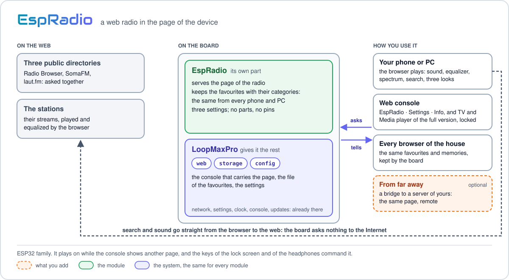
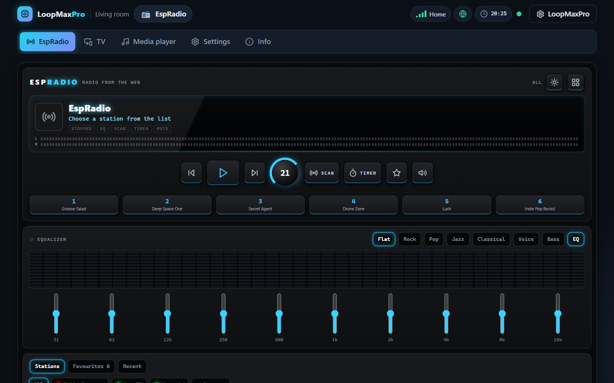

<p align="center"><a href="../../../README.md"></a>&nbsp;&nbsp;&nbsp;</p>

<p align="center"></p>

<p align="center"><em>A web radio in the page of the device: the browser plays, the board keeps the favourites.</em><br>
A free module for <a href="../../../README.md">LoopMaxPro</a></p>

<p align="center">
<a href="../../../README.md">Home</a> &nbsp;·&nbsp;
<a href="../../../docs/README.md">Documentation</a> &nbsp;·&nbsp;
<a href="../../../README.md#modules">All modules</a> &nbsp;·&nbsp;
<a href="CHANGES.md">Versions</a> &nbsp;·&nbsp;
<a href="https://smartilab.it/firmware/">Web flasher</a>
</p>

---

<h2 id="overview"></h2>

<p align="center">

</p>

EspRadio puts a radio in the web console of a LoopMaxPro board. The stations are looked for in
three public directories at once, then played and equalized by the browser that shows the page:
the sound comes out of the phone or of the PC, not of the board. The board serves the page and
keeps what must be the same from every phone and PC: the favourite stations with their
categories, and three settings.

It needs no parts and no wiring: a board of the ESP32 family with LoopMaxPro is enough. It is
for who wants a radio on the home network without installing an app, and for who looks for an
example of a module that is almost all interface.

| Where | What lives there |
|-------|------------------|
| The browser | The sound, the equalizer, the spectrum and the levels, the search in the directories, the volume, the look and the colour of the lights, the last stations listened to |
| The board | The page itself, the favourites with their categories (`/espradio/favs.jsonl`), the settings |

The board asks nothing to the Internet: the directories and the streams are called by the page.

A full version with a TV and a media player, EspWebMedia, is sold by SmartiLab: [smartilab.it/shop](https://smartilab.it/shop/). The free page shows those two tabs locked.

<p align="center">
<br>
<em>The page of the module in the web console.</em>
</p>

<h2 id="features"></h2>

- **Three looks**, changed with a key: a car stereo of matte black with lights in one of seven
  colours, a stage amplifier with needle meters and a volume that goes to eleven, a neon sign.
- **Three directories asked together**: [Radio Browser](https://www.radio-browser.info),
  [SomaFM](https://somafm.com) and [laut.fm](https://laut.fm). A reserve of 16 stations inside
  the page plays when Radio Browser does not answer.
- **One search box**: the words are looked for in the names and in the genres, and a country
  written there becomes the country. Genres and countries are chosen by writing a few letters.
  A country with little to give is followed by the rest of the world.
- **Five orders**: most listened, most voted, trending, by name, near the device.
- **Equalizer with ten bands** and seven presets, a spectrum and two level meters.
- **Favourites kept by the board**, the same from every phone and PC, with categories of your
  own; the first six on the memory keys; export to a file and import from it; stations of
  yours by the address of their stream.
- **The keys of a radio**: before and next in the list in sight, scan, sleep timer, mute.
- **The buttons of the lock screen and of the headphones** command the radio, and the title on
  air is shown where the directory tells it (SomaFM, laut.fm).
- **It plays on** while the console shows another page.

<h2 id="hardware"></h2>

| | |
|---|---|
| Boards | ESP32 family (ESP32, S2, S3, C3, C6). The suggested one is an ESP32-C3, environment `esp32c3_usb` |
| Parts | None |
| Pins | None |
| With other modules | Not together with [ExpNet](../expnet/README.md): the two pages are more than a device carries, and the build refuses the pair |

How many favourites a board keeps depends on its memory:

| Environment | Favourites |
|-------------|-----------:|
| `esp32c3`, `esp32c3_usb` | 30 |
| `esp32dev`, `esp32s2_mini`, `esp32c6_n16`, `heltec_v3` | 80 |
| `esp32s3_n8` | 200 |

The `_idf` environments of the same boards have the same numbers. The boards are described in
[Boards](../../../docs/boards.md).

<h2 id="build-and-flash"></h2>

**Without a build:** the [web flasher](https://smartilab.it/firmware/) of SmartiLab installs a
ready firmware from the browser: choose the firmware and a compatible board. The rest of this
section is for who builds it with PlatformIO.

The modules of a firmware are named in `custom_lmp_modules`. Add an environment of your own to
`platformio.ini`, on top of the one of your board:

```ini
[env:espradio_c3]
extends = env:esp32c3_usb
custom_lmp_modules = espradio
```

```
pio run -e espradio_c3 -t upload
```

Or leave the files as they are and name the module in the `LMP_MODULES` variable of the shell,
which wins over the option:

```
LMP_MODULES=espradio pio run -e esp32c3_usb -t upload              # Linux, macOS
$env:LMP_MODULES = "espradio"; pio run -e esp32c3_usb -t upload    # Windows PowerShell
```

On the ESP32 family the console travels inside the firmware: one upload is all. A new board
starts as the access point `LoopMax-XXXX` (password `loopmaxap`) with the console on
`http://192.168.4.1`. More in [Build and flash](../../../docs/build.md).

<h2 id="using-it"></h2>

The module has five tabs in the console:

| Tab | What it has |
|-----|-------------|
| EspRadio | The radio: head unit, equalizer, stations |
| TV, Media player | Locked: they show what the full version has |
| Settings | The three settings below |
| Info | Version, commands and document of the module |

### The radio

| Panel | What it has |
|-------|-------------|
| Head unit | A display with the logo, the name and the info of the station, or the title on air; the lamps (ON AIR, TUNING, NO SIGNAL, EQ, SCAN, TIMER, MUTE); two levels, left and right; the keys; six memories |
| Equalizer | The spectrum of what plays, ten bands from 31 Hz to 16 kHz (12 dB up or down), the presets Flat, Rock, Pop, Jazz, Classical, Voice and Bass, and the EQ key that takes the equalizer out or puts it in again |
| Stations | Three lists: Stations (the search), Favourites, Recent (the last 20 stations this browser listened to) |

| Key | What it does |
|-----|--------------|
| Station before, Next station | Move in the list in sight: the stations found, the favourites or one of their categories |
| Listen, Stop | Play the station, or stop it |
| Volume knob | 0 to 30; 0 to 11 on the amplifier |
| SCAN | Plays each station of the list for the seconds of the settings, until you stop. A station that does not answer is passed over |
| TIMER | Sleep timer: 15, 30, 60 or 90 minutes, then off |
| Favourite | Adds the station on air to the favourites, or removes it |
| Mute | Silence, without stopping the station |
| Memories 1 to 6 | The first six favourites. An empty one takes the station on air |
| Change the look | Car stereo, amplifier, neon |
| Colour of the lights | On the car stereo: one of seven colours |

### Looking for a station

- **All** asks Radio Browser, SomaFM and laut.fm together and puts the answers in one list;
  each directory has a lamp, green when it answered, and can be chosen alone. SomaFM has
  stations of the United States only and laut.fm of Germany only: they are silent when another
  country is chosen.
- The text is looked for in the names and, with no genre chosen, among the genres too. A
  country written as the text, in the language of the console or in English, becomes the
  country.
- The keys **Genre** and country open a box that filters while you write.
- With a genre or a text, a country that gives fewer than twelve stations is followed by the
  ones of the rest of the world, and the page says so.
- The lists come forty stations at a time: **MORE** asks for the next ones.
- **Near the device** uses the position of the device (set in the system, under Time & place).

In **Favourites** you choose the category of each station, add, rename and remove categories,
add a station of yours by name and address of the stream, export the favourites to
`espradio.json` and import them again.

### Settings

| Setting | Values | Default | Meaning |
|---------|--------|---------|---------|
| `cats` | text, up to 159 characters | empty | The categories of the favourites, in their order, a comma between them |
| `country` | two letters, as `IT` | empty | The country the search starts from. Empty: the one of the browser |
| `scanSec` | 3 to 60 | 8 | Seconds on each station while scanning |

The volume, the equalizer, the look and the recent stations are kept by each browser, not by
the board.

### Commands

The target is `mod.espradio`. The page uses these commands; they are also there for the serial
console, the HTTP API and MQTT.

| Command | Arguments | What it does |
|---------|-----------|--------------|
| `favs` | `from` (optional, 0 to 999) | The favourites, a page at a time. The answer has `count`, `max`, the list `favs` and, when there are more, `next`: the value of `from` for the next page |
| `fav.set` | `id`, and optional `name`, `url`, `cat`, `logo`, `info` | A favourite, new or changed. A new one needs `name` and `url`; only the arguments given are changed |
| `fav.remove` | `id` | Forgets a favourite |
| `cat.rename` | `from`, `to` | Gives the favourites of a category another one; an empty `to` leaves them without category |

| Argument | Limits |
|----------|--------|
| `id` | 2 to 23 characters: letters, digits and `. _ : -` |
| `name` | 1 to 43 bytes |
| `url` | 8 to 159 bytes, beginning with `http://` or `https://` |
| `cat` | up to 19 bytes |
| `logo` | up to 119 bytes: the address of a picture |
| `info` | up to 59 bytes |

```
cmd mod.espradio fav.set id=myradio name="My radio" url=https://example.org/stream.mp3 cat=Rock
cmd mod.espradio favs
cmd mod.espradio cat.rename from=Rock to=Loud
```

A command carries at most 256 characters of text, so the page sends a new favourite in two
commands: name and address first, then logo and info. On the board a favourite is a line of
JSON in `/espradio/favs.jsonl`, with short names: `i` id, `n` name, `u` address, `c` category,
`l` logo, `t` info. The serial console is described in
[Serial console](../../../docs/serial-console.md), the routes in
[HTTP API](../../../docs/http-api.md).

### Good to know

- The equalizer, the spectrum and the levels work on the stations that let a page read their
  sound (CORS). The others play all the same, straight to the speakers: the EQ lamp turns red
  and the panel says why.
- A page that came by https plays https stations only: there Radio Browser is asked for those
  alone, and a station in http is tried in https. From the page of the device on your network,
  which comes by http, every station is listed.
- HLS stations play in the browsers that play HLS by themselves; elsewhere the display says so.
  On Safari and on every browser of an iPhone they play without the equalizer.
- **Near the device** sends Radio Browser the position of the device rounded to a tenth of a
  degree, about 10 km.
- Radio Browser is told when one of its stations is played: its lists of the most listened
  come from these counts.
- With MQTT on and a broker set, the device shows in Home Assistant one sensor, `favs`: how
  many favourite stations it keeps, out of how many it can. The sound is of the browser, so
  there is nothing on the board to turn on or off. The same number is what a program reads
  from the things of the module, through the HTTP API.
