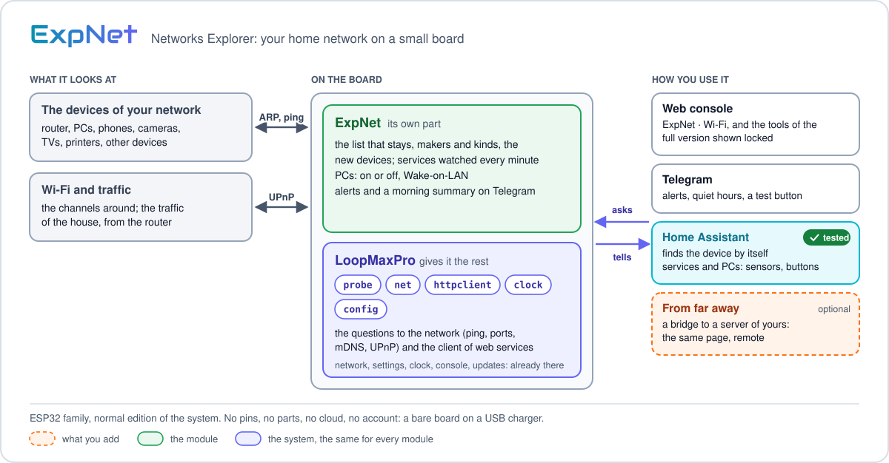
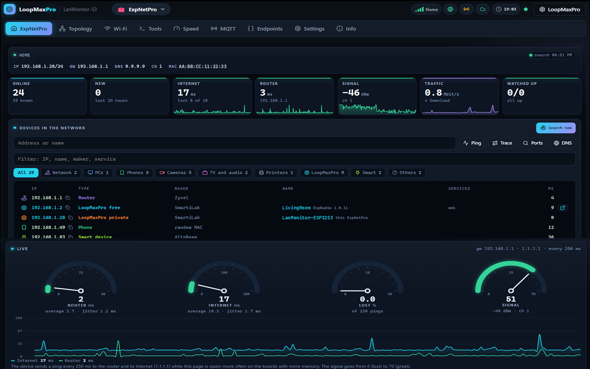

<p align="center"><a href="../../../README.md"></a>&nbsp;&nbsp;&nbsp;</p>

<p align="center"></p>

<p align="center"><em>Networks Explorer: your home network on a small board.</em><br>
A free module for <a href="../../../README.md">LoopMaxPro</a></p>

<p align="center">
<a href="../../../README.md">Home</a> &nbsp;·&nbsp;
<a href="../../../docs/README.md">Documentation</a> &nbsp;·&nbsp;
<a href="../../../README.md#modules">All modules</a> &nbsp;·&nbsp;
<a href="CHANGES.md">Versions</a> &nbsp;·&nbsp;
<a href="https://smartilab.it/firmware/">Web flasher</a>
</p>

---

<h2 id="overview"></h2>

<p align="center">

</p>

ExpNet turns an ESP32 board into an explorer of your home or small-office network. Leave the
board plugged into a USB charger: it finds the devices on the network and recognises their maker
and kind, tells you when a new one shows up, watches the services you care about, wakes your PCs,
surveys the Wi-Fi channels and sends alerts to Telegram. When the router can tell it, it also
shows the traffic of the house.

Everything is in the web console of the board, on a page with the look of a network monitor. The
module needs no cloud and no account: the board does the network work and keeps what it finds in
its own flash. It uses no pins and no extra parts.

It is for who runs a home or small-office network and wants something always on that looks at
it, and for developers who want to know what is on the network they work in.

| | |
|---|---|
| Module | `expnet` |
| Command target | `mod.expnet` |
| Kind | `online` |
| Boards | ESP32 family, normal edition of the OS |
| Pins | none |
| OS services | required: `net`, `probe`, `httpclient`, `config`; optional: `clock`, `mqtt` |
| Hosts outside your network | `1.1.1.1` for the live ping; `api.telegram.org`, only when Telegram is set |

A full version with more tools, ExpNetPro, is sold by SmartiLab ready on its own board: see the [SmartiLab shop](https://smartilab.it/shop/). The page of the free module shows those tools locked.

<p align="center">
<br>
<em>The page in the web console, shown here in the full version, ExpNetPro: the free module has this first tab, and shows the tools of the full version locked.</em>
</p>

<h2 id="features"></h2>

- **Who is on the network.** A search starts by itself every 15 minutes (you choose how often, or
  only by hand): ARP on the whole subnet, ping, mDNS and UPnP. Also the PCs that do not answer
  the ping are found.
- **Maker and kind.** Each device is shown as a router, access point, PC, phone, camera, video
  recorder, TV, smart speaker, printer, NAS, server or smart device, with the maker of its
  network card taken from the IEEE registry. You can give any device a name and a kind of yours.
- **A list that stays.** The list is kept on the board. A device that is gone stays in it, with
  the time it was last seen.
- **New devices.** A device never seen before is marked as new for 24 hours, written in the log
  and told on Telegram.
- **Other LoopMaxPro devices** are shown apart, with their module, firmware version and a link to
  their console.
- **Live tiles.** Response time of the router and of the Internet, lost pings, Wi-Fi signal.
- **Traffic of the house**, read from a router with UPnP, a Starlink dish, a Huawei 4G/5G router
  or a router with SNMP.
- **Watched services.** A ping, a TCP port or a web page, checked every minute, with 7 days of
  history and the uptime of the last 24 hours.
- **PCs.** Wake-on-LAN, whether each PC is on, and a webhook to turn it off.
- **Wi-Fi.** The networks around and the least crowded channel.
- **Telegram.** Alerts, a morning summary, quiet hours, a test button.
- **Home Assistant.** Watched services and PCs become sensors and buttons.
- **Quiet when nobody looks.** A page out of sight asks nothing, and the live pings stop.
- The page speaks English and Italian.

<h2 id="hardware"></h2>

A bare board and a USB power supply: ExpNet uses no pins and needs no parts or wiring.

| Board | PlatformIO environment | Memory class |
|---|---|---|
| ESP32 with 4 MB of flash (ESP32-WROOM): the default board of the module | `esp32dev`, `esp32dev_idf` | medium |
| ESP32-S3 N8R2 (8 MB of flash, 2 MB of PSRAM) | `esp32s3_n8`, `esp32s3_n8_idf` | large |
| Heltec WiFi LoRa 32 V3 | `heltec_v3`, `heltec_v3_idf` | medium |
| ESP32-C6 with 16 MB of flash | `esp32c6_n16` (ESP-IDF only) | medium |
| ESP32-C3 with 4 MB of flash | `esp32c3`, `esp32c3_usb`, `esp32c3_idf`, `esp32c3_usb_idf` | small |

The environments are defined in [boards/esp32.ini](../../../boards/esp32.ini) and
[boards/esp32_idf.ini](../../../boards/esp32_idf.ini); see [Boards](../../../docs/boards.md).
The module is not built for the light edition of the OS: the ESP8266 boards and the ESP32-S2
mini.

What ExpNet keeps and how often it asks follows the memory class of the board. The C3 works,
with the smallest limits: a 4 MB ESP32 or better is the suggested choice.

| | Small | Medium | Large |
|---|---|---|---|
| Devices kept in the list | 128 | 254 | 512 |
| Events kept in the log | 64 | 200 | 1000 |
| Watched services / PCs | 16 / 16 | 24 / 24 | 32 / 32 |
| Live ping, one every | 1000 ms | 500 ms | 250 ms |
| Traffic of the house, one reading every | 2 s | 1.5 s | 1 s |
| Telegram: messages waiting / longest message | 3 / 640 | 5 / 1500 | 8 / 3500 |
| UPnP search by kind, camera ports | no | yes | yes |
| Larger table of makers | no | yes | yes |

The Wi-Fi of these boards is 2.4 GHz only: the board must join a 2.4 GHz network, and the Wi-Fi
tab shows only those.

<h2 id="build-and-flash"></h2>

**Without a build:** the [web flasher](https://smartilab.it/firmware/) of SmartiLab installs a
ready firmware from the browser: choose the firmware and a compatible board. The rest of this
section is for who builds it with PlatformIO.

You need [PlatformIO](https://platformio.org/) and the sources of LoopMaxPro; the general steps
are in [Build and flash](../../../docs/build.md). The modules of a firmware are chosen at build
time. ExpNet has no build parameters, so its name is enough.

Without touching any file, set `LMP_MODULES` and build one of the environments of the table
above:

```sh
# Linux, macOS
LMP_MODULES=expnet pio run -e esp32dev -t upload
```

```powershell
# Windows PowerShell
$env:LMP_MODULES = "expnet"
pio run -e esp32dev -t upload
```

Or add an environment of your own, in `platformio.ini` or in a new file under `boards/`:

```ini
[env:expnet]
extends = env:esp32dev
custom_lmp_modules = expnet
```

```sh
pio run -e expnet              # build
pio run -e expnet -t upload    # build and flash
```

`LMP_MODULES`, when set, wins over `custom_lmp_modules`. To put more modules in one firmware,
write their names separated by spaces or commas. The build prints `LoopMaxPro modules: expnet`
when the module is in. On the ESP32 family the console and the page of the module are inside the
firmware: there is no filesystem image to upload.

After the first start, join the board to your Wi-Fi from its console as for any LoopMaxPro
device. ExpNet starts by itself: the first search of the network runs one minute after the board
is on the network.

<h2 id="using-it"></h2>

### The page

Open the console of the board and choose **ExpNet**. The page has six tabs, plus the standard
settings page of the module.

| Tab | What it shows |
|---|---|
| **ExpNet** | The network of the board (name, address and mask, gateway, DNS, channel, MAC). Tiles: devices online and known, new devices, Internet and router response time, signal, traffic, watched services up. The list of the devices, with **Search now**, a filter and one button for each kind. The log of what happened. The watched services and the PCs. The state of Telegram, with **Test** |
| **Wi-Fi** | The networks around, with signal, channel and whether they are protected, drawn on the channels they take; the best channel among 1, 6 and 11. **Search networks** starts a scan |
| **Tools**, **Speed**, **MQTT**, **Endpoints** | Shown with their forms, to explore, but locked: they are part of the full version. Starting one opens a window with a link to the shop |

Above the list and in the card of a device, the buttons **Ping**, **Trace**, **Ports**, **DNS**
and **HTTP** open the Tools tab, so they are locked too.

### The search of the network

The first search starts one minute after the board joins the network, then one every
`scanEveryMin` minutes (15 by default; 0: only by hand). **Search now** starts one at once. A
search asks one thing at a time, in this order:

| Step | What it asks | Boards |
|---|---|---|
| ARP | every address of the subnet, up to 254: who is there, with its MAC | all |
| Ping | each device found, for its response time | all |
| mDNS | ten kinds of service: web page, printer, Chromecast, HomeKit, Home Assistant, shared folders, SSH, MQTT, ESPHome, AirPlay | all |
| UPnP (SSDP) | every device, for the name it tells of itself | all |
| UPnP by kind | routers, access points, TVs and sticks, media players | medium, large |
| Camera ports | TCP ports 554, 8000, 37777, 34567, 9010, 9020 and 7681 of each device found, except the ones with a random MAC, the LoopMaxPro devices and the board itself | medium, large |

The first complete search is the baseline. After it, a device never seen before is **new** for
24 hours. A MAC with the local-address bit set is a random MAC: the mark of a phone or a tablet.
A device that is gone stays in the list, greyed, with the time it was last seen; when the list
is full, the place of the one not seen for the longest time is taken.

The kind of a device is the one you chose for it. Without one, the page works it out from what
the device announces (mDNS services, UPnP kind), its camera ports, its name, its maker and a
random MAC. The device at the address of the gateway is the router. The maker comes from the
first half of the MAC: a short table from the IEEE registry is inside the page, and medium and
large boards add a larger one from the firmware.

### The card of a device

Tap a device to open its card: address, kind, MAC, maker, camera ports, mDNS name, what it tells
to UPnP, services, ping time, when it was first and last seen. From the card you can:

- **Watch** it: it becomes a watched service.
- **Wake** it: it becomes a PC, and the wake packet is sent.
- open its web page when the search found one, or the console of a LoopMaxPro device;
- give it a name and a kind of yours.

### Watched services

| Check | The service is up when | Wait |
|---|---|---|
| `ping` | the device answers the ping | 1 s |
| `tcp` | the port takes the connection | 2 s |
| `http` | the page answers with a status from 200 to 399 | 5 s |

`ping` and `tcp` want an IP address; `http` takes a host name too, and only `http://` pages. A
service is checked every 60 seconds unless you choose another period, from 10 seconds to one
hour. It is down after two failed checks in a row, and up at the first good one. While the board
is off its network the checks wait: a service out of sight is not a service down.

Each service keeps 7 days of history in blocks of 15 minutes: checks made, checks answered,
average time. The page draws the last 24 hours or the week.

### PCs

A PC has a name and a MAC, and optionally an IP address (to know whether it is on), a TCP port
for the state (empty: the ping), a broadcast address (empty: the one of the network) and a
webhook to turn it off.

- **Wake** sends the Wake-on-LAN packet three times, then checks the PC every 5 seconds for
  3 minutes and tells how long it took to come up.
- The state is checked once a minute. With a port, a PC that refuses the connection is on too.
- **Turn off** is there only when the PC has a webhook: the board sends an HTTP `POST` with the
  JSON body `{}` to that address, for example a webhook of Home Assistant.

Wake-on-LAN must be enabled on the PC, in the BIOS and on the network card. It works on a cable;
over Wi-Fi almost never.

### Traffic of the house

The Traffic tile shows the download of the whole house, as the device on your Internet line
tells it. The board tries these sources in this order and reads the first that answers. A source
that is missing is looked for again a minute later, while the page is open.

| Source | What the device must offer | Where it is asked |
|---|---|---|
| Router with UPnP | UPnP (IGD) with the `WANCommonInterfaceConfig` service | the router of the network, found with SSDP |
| Starlink dish | its local status interface | `192.168.100.1`, TCP port 9201 |
| Huawei 4G/5G router | its HiLink page `/api/monitoring/traffic-statistics`, readable without a login | the router of the network, over HTTP |
| Router with SNMP v2c | the standard interface counters (IF-MIB) and a read community | the router of the network, UDP port 161 |

`trafficFrom` asks one kind only. `upnpHost` is the address of the device to read, also in
another subnet, as `IP` or `IP:port`; the port is used for Starlink, Huawei and SNMP. SNMP is
asked only after you write the community of your router in `snmpCommunity`: it is empty by
default. When the router answers SNMP but does not tell its routes, write the number of its
interface towards the Internet in `snmpIf`. A UPnP router whose byte counter is stuck at its top
is read by its packets: the value is then an estimate, and the answer of `live` says so.

One device is read, and what it says of its own line: not the traffic of a single PC.

### Telegram

Make a bot with @BotFather, then write its token and your chat in the settings of the module.

| Message | Setting | Default |
|---|---|---|
| A watched service does not answer; it is back, and for how long it was down | `notify` | on |
| A new device in the network: address, MAC, name | `notifyNew` | on |
| A PC goes on or off | `notifyPc` | off |
| Internet is back, and for how long it was gone | `notifyNet` | on |
| Morning summary: devices online, new ones, services up, PCs on, Internet | `summaryHour` | off |

Between `quietFrom` and `quietTo` the messages arrive without a sound. Messages go out one at a
time; when too many wait, the oldest is dropped. The free module only sends: it never asks
Telegram for commands.

### Settings

| Field | Default | Values | Meaning |
|---|---|---|---|
| `telegramToken` | empty | up to 64 characters | Token of the Telegram bot. A secret: the console never gives it back |
| `telegramChat` | empty | up to 24 characters | The chat the messages go to |
| `botCommands` | off | locked | Commands from the bot: part of the full version, shown off and locked |
| `notify` | on | on, off | Message when a service falls or comes back |
| `notifyNew` | on | on, off | Message for a new device in the network |
| `notifyPc` | off | on, off | Message when a PC goes on or off |
| `notifyNet` | on | on, off | Message when the Internet is back |
| `summaryHour` | 24 | 0 to 24 | Hour of the morning summary; 24: never |
| `quietFrom` | 24 | 0 to 24 | Messages without sound from this hour; 24: never |
| `quietTo` | 7 | 0 to 23 | ... until this hour |
| `scanEveryMin` | 15 | 0 to 1440 | Search of the network every so many minutes; 0: only by hand |
| `everySec` | 60 | 10 to 3600 | Check period given to a new watched service |
| `trafficFrom` | 0 | 0 to 4 | Who tells the traffic: 0 found by itself, 1 router with UPnP, 2 Starlink dish, 3 Huawei 4G/5G router, 4 router with SNMP |
| `upnpHost` | empty | `IP` or `IP:port` | The device that tells the traffic; empty: found by itself |
| `snmpCommunity` | empty | up to 24 characters | SNMP community; empty: SNMP is never asked |
| `snmpIf` | 0 | a number | SNMP: interface of the router towards the Internet; 0: found by itself |

### Commands

Everything the page does is a command of the target `mod.expnet`, so it can also be run from the
[serial console](../../../docs/serial-console.md), as `cmd <target> <command> [name=value]`, and
over the [HTTP API](../../../docs/http-api.md), as `POST /api/cmd/<target>/<command>` with the
arguments as JSON:

```
cmd mod.expnet service.add name=NAS check=ping host=192.168.1.20
POST /api/cmd/mod.expnet/scan
```

| Command | Arguments | What it does |
|---|---|---|
| `scan` | none | Starts a search of the network now |
| `hosts` | `from?` | The devices of the list, 16 a page; `next` says where the following page starts |
| `host.alias` | `ip`, `mac?`, `alias?`, `type?` | A name or a kind of yours for a device; at least one of the two. An empty `type` gives the kind back to the page. Kinds: `router`, `ap`, `pc`, `phone`, `camera`, `nvr`, `tv`, `speaker`, `printer`, `nas`, `server`, `iot`, `other` |
| `makers` | `from?` | The larger table of makers, a page at a time; empty on small boards |
| `live` | none | Response times of the router and of the Internet, signal, traffic. Asking it keeps the live pings going |
| `events` | `from?` | The log, 20 events at a time, the latest first |
| `service.add` | `name`, `check`, `host`, `port?`, `path?`, `everySec?` | A service to watch; `check` is `ping`, `tcp` or `http`. `tcp` needs `port`; `http` uses 80 without one. Answers its `id` |
| `service.update` | `id`, `name?`, `host?`, `port?`, `path?`, `everySec?` | Changes a watched service |
| `service.remove` | `id` | Stops watching a service; its history goes too |
| `service.check` | `id` | Checks a service now |
| `history` | `id`, `range?` | The history of a service; `range` is `day` (default) or `week` |
| `pc.add` | `name`, `mac`, `host?`, `broadcast?`, `port?`, `offUrl?` | A PC to wake. Answers its `id` |
| `pc.update` | `id`, `name?`, `host?`, `broadcast?`, `port?`, `offUrl?` | Changes a PC |
| `pc.remove` | `id` | Forgets a PC |
| `pc.wake` | `id` | Sends the Wake-on-LAN packet |
| `pc.off` | `id` | Calls the webhook that turns the PC off |
| `notify.test` | none | Sends a test message to Telegram |

### Helper scripts

In the `tools` folder of the module, for who works on it. They need Python only.

| Script | Use |
|---|---|
| [tools/fake_wan.py](tools/fake_wan.py) | A fake Starlink dish, Huawei router and SNMP router on your PC, to try the traffic sources without owning one |
| [tools/live_watch.py](tools/live_watch.py) | Asks a board its `live` command every two seconds and prints who tells the traffic |

### Good to know

- The history of a service and the "new" mark need the time of the device: it has it as soon as
  it reaches the Internet.
- The OS asks the network one question at a time: while a search runs, the live tiles can show
  gaps.
- A network larger than a /24 is searched only in the 254 addresses around the board.
- A device that does not answer ARP and announces nothing is not seen.
- When nobody has used the module for half an hour, and there is nobody to tell (no Telegram
  message set for new devices or for the morning, no MQTT broker and no
  [cloud bridge](../../../docs/cloud.md) connected), the search by itself waits for the first
  look. Watched services and PCs are always checked.

<h2 id="network-footprint"></h2>

ExpNet is a tool to look at your own network. This is what the free module sends, to whom and
when. The questions to the network are asked for it by the probe service of the OS
([src/services/probe](../../../src/services/probe)) and by its web client.

| Function | What it sends | To whom | When |
|---|---|---|---|
| Search of the devices | ARP requests; one ping to who answers; mDNS questions for 10 kinds of service, and the one of the OS for other LoopMaxPro devices; SSDP searches (1 on small boards, 5 on the others); on medium and large boards a TCP connection, opened and closed with no data, to 7 ports typical of cameras and recorders | the local network of the board, at most 254 addresses | by itself every 15 minutes (you choose; 0: only by hand) and on request; it rests when nobody looks and nobody is to be told |
| Live tiles | one ping every 250 to 1000 ms, by board | the router and `1.1.1.1` | while the page is open; it stops 15 seconds later |
| Traffic of the house | an SSDP search for the router, then readings only: the counters of a router with UPnP, the status of a Starlink dish, the traffic page of a Huawei router, the interface counters of a router with SNMP | the router of the network, the dish, or the device you wrote in the settings | while the page is open, one reading every 1 to 2 seconds |
| Watched services | one ping, or one TCP connection opened and closed, or one HTTP `GET` of a page | the services you added | every 10 to 3600 seconds, as you choose |
| PCs | the Wake-on-LAN packet (UDP port 9, three times); a ping or a TCP connection for the state; an HTTP `POST` to turn off | the PCs you saved; the webhook you wrote | wake and turn off on request; the state once a minute |
| Wi-Fi | the standard Wi-Fi scan of the board, as a phone does to list the networks: name, channel, signal, whether protected | nobody in particular; it joins none of them | on request |
| Telegram | messages to your bot, over HTTPS | `api.telegram.org` | when something happens, as set; never without a token and a chat |
| Tools, Speed, MQTT, Endpoints | nothing: in the free module they do not run | | |

**What the module never does.**

| Never | How you can check it |
|---|---|
| **Access attempts.** No password, user name or factory credential is ever tried on a device | The sources of the module hold no login request to a network device. The only credentials used are the ones you write: the token of your Telegram bot and the SNMP community, which is empty by default, and without it SNMP is not asked |
| **Listening to the traffic of other devices** | The radio is never put in promiscuous mode. The board sees only the packets sent to it and the announcements every device of the network receives (ARP, mDNS, SSDP) |
| **Forged packets.** No ARP spoofing, no forced Wi-Fi disconnections, no hand-made Wi-Fi frames, nothing that pretends to be another device | The module talks to the network only through the probe service of the OS, whose questions are listed in [src/hal/api/iprobe.h](../../../src/hal/api/iprobe.h), and through its web client |
| **Changes to devices.** No setting is written on a router or on any device | UPnP is used only to read counters: no port is opened on the router. SNMP is used only with read requests (`GET` and `GETNEXT`, never `SET`). The Starlink dish and the Huawei router are asked only their status |
| **Hidden scans** | The camera ports are tried with normal, complete TCP connections, which the device sees and can log. No data is sent and no banner is read: only open or closed |
| **Load on the network** | One question at a time, a few connections together at most, with fixed waits. With nobody looking, the live readings stop |

**What leaves your local network.** From the module, only: the live ping to `1.1.1.1`; the
messages to Telegram, when you set it; and a watched service, a webhook or a traffic device whose
address you wrote yourself, when that address is outside.

**Where the data stays.** In files on the board, under `/expnet/`: `list.json` (watched services
and PCs), `hosts.bin` and `count.bin` (the devices found: address, MAC, names, kind), `h<id>.bin`
(the history of a service) and `log.bin` (the log). The console shows them to who has access to
the board. They leave the board only towards what you set up: your Telegram chat, your Home
Assistant and, in a firmware that has one, the [cloud bridge](../../../docs/cloud.md) of the OS.

<h2 id="home-assistant"></h2>

When the MQTT service of the OS is connected to your broker and tells Home Assistant what the
modules show (MQTT discovery), ExpNet declares these things. How to set it up is in
[Discovery, MQTT and Home Assistant](../../../docs/network-and-home-assistant.md).

| Thing | In Home Assistant | Notes |
|---|---|---|
| `s<id>` | binary sensor, class `connectivity` | One for each watched service, with its name: on when the service is up |
| `l<id>` | sensor in ms, among the diagnostics | The last response time of the service, named after it; no value while it is down |
| `p<id>` | binary sensor, class `power` | One for each PC that has an IP address: on or off |
| `w<id>` | button | One for each PC: sends the Wake-on-LAN packet |
| `net` | sensor | "Devices in the network": how many the last search found |

`<id>` is the number of the service or of the PC. It never moves: removing one does not shift
the others, so their entities stay the same. A new service or PC takes the first free number.
