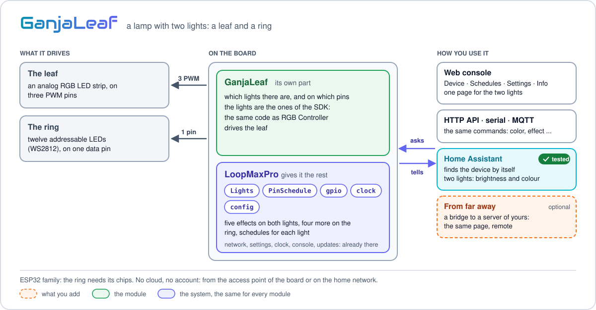
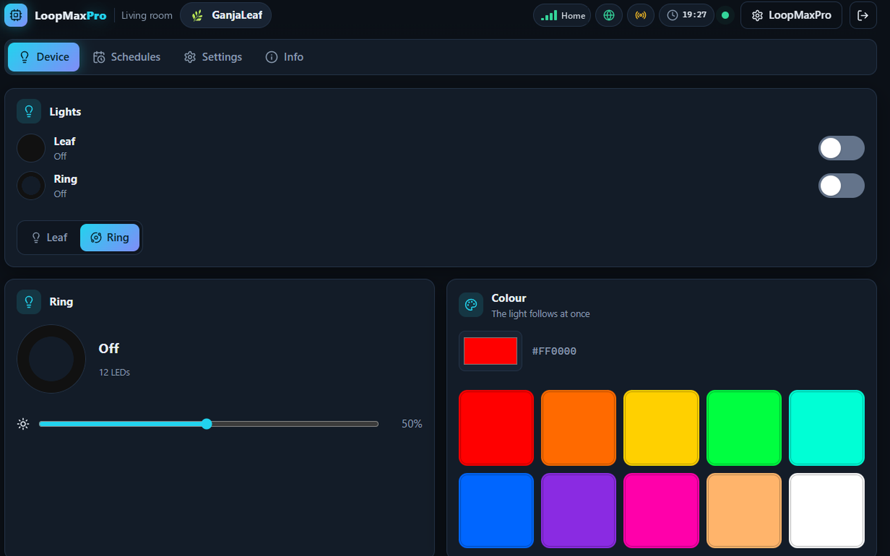
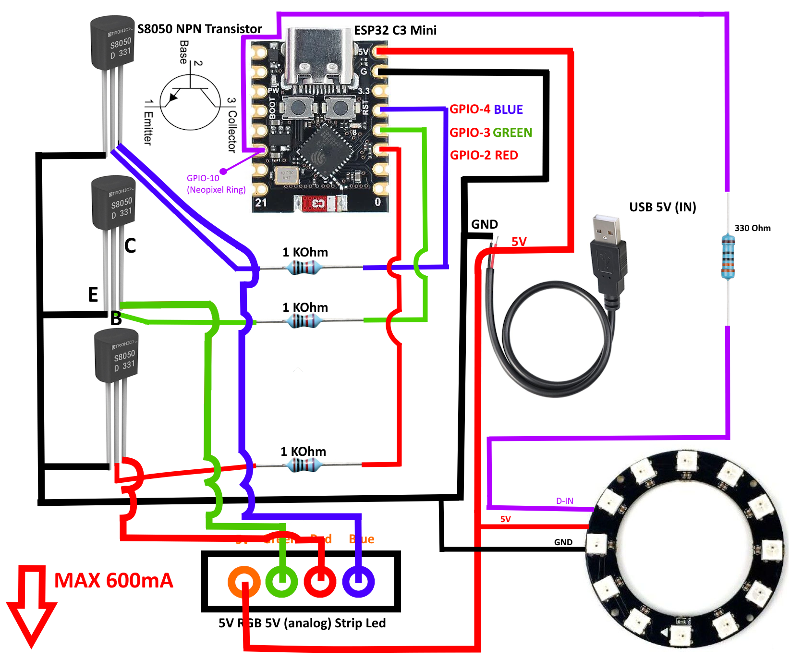

<p align="center"><a href="../../../README.md"></a>&nbsp;&nbsp;&nbsp;</p>

<p align="center"></p>

<p align="center"><em>A 3D-printed lamp in the shape of a leaf: an RGB strip in the leaf, a ring of LEDs in the base.</em><br>
A free module for <a href="../../../README.md">LoopMaxPro</a></p>

<p align="center">
<a href="../../../README.md">Home</a> &nbsp;·&nbsp;
<a href="../../../docs/README.md">Documentation</a> &nbsp;·&nbsp;
<a href="../../../README.md#modules">All modules</a> &nbsp;·&nbsp;
<a href="CHANGES.md">Versions</a> &nbsp;·&nbsp;
<a href="https://smartilab.it/firmware/">Web flasher</a>
</p>

---

<h2 id="overview"></h2>

<p align="center">

</p>

GanjaLeaf is a lamp printed in 3D in the shape of a leaf, with two lights: an analog RGB LED
strip in the **leaf** and a **ring** of twelve addressable LEDs (WS2812, "NeoPixel") in the
base. Each light has its own colour or effect, its brightness, its speed and its schedules.
The lamp is commanded from the phone, from the access point of the board or on the home
network: no cloud and no account.

The two lights are those of the SDK ([src/sdk/lights.h](../../sdk/lights.h)), the same as
[RGB Controller](../rgb/README.md): the module only says which lights there are and on which
pins ([src/ganjaleaf.cpp](src/ganjaleaf.cpp)).

This repository has the firmware and the circuit of the lamp. The files for the 3D printer are
not part of it.

<p align="center">
<br>
<em>The page of the module in the web console.</em>
</p>

<h2 id="features"></h2>

- **Two lights, each on its own**: leaf and ring have their colour, effect, brightness, speed
  and switch.
- **Five effects on both**: Christmas, Rainbow, Breath, Blink, Fade.
- **Four more on the ring**, where every LED has its colour: Chase, Turning rainbow, Comet,
  Sparkles.
- **Schedules for each light**: every week on the days you choose, or once; four for the leaf
  and four for the ring.
- **After a power cut** the lights come back as they were, if you want them to.
- **Home Assistant**: two lights with brightness and colour, each with its effect to choose
  and the speed of the effect to set.

<h2 id="hardware"></h2>

| | |
|---|---|
| Boards | ESP32 family. The ready-made product is on an ESP32-C3 Supermini. Not on the ESP8266: the ring is driven by the RMT of the ESP32 chips |
| Leaf | Analog RGB LED strip, common positive, on three PWM pins |
| Ring | Addressable LEDs (WS2812) on one data pin: 12 in the lamp, 64 at most |
| PWM of the leaf | 10 bits where the chip has them, 8 otherwise; 5000 Hz, changed in the settings |

### Parts

| Part | Pieces |
|------|-------:|
| ESP32-C3 Supermini | 1 |
| S8050 NPN transistor | 3 |
| 1 kΩ resistor | 3 |
| 5 V analog RGB LED strip (5V, G, R, B) | 1 |
| Ring of 12 WS2812 LEDs | 1 |
| 330 Ω resistor | 1 |
| 5 V USB supply | 1 |
| The printed leaf and base | 1 |

### Wiring

The leaf is wired as in [RGB Controller](../rgb/README.md#hardware): each colour has its S8050
on the low side of the strip, with the pin of the colour on the base through 1 kΩ, the emitter
on GND and the collector on the wire of that colour. The ring takes 5 V, GND and the data: its
D-IN goes to the data pin through the 330 Ω resistor. Everything is fed with 5 V by the USB
supply.

The drawing marks 600 mA as the most the circuit is to carry. A ring at full white asks more
current than a USB port gives: for this the ring is born at half brightness.

<p align="center">

</p>

### Pins

The pins of each board are in `boardPins` of [module.json](module.json); pins given in the
build win over them.

| Board | Leaf red | Leaf green | Leaf blue | Ring data |
|-------|---------:|-----------:|----------:|----------:|
| Ready-made product `ganjaleaf_c3` (ESP32-C3 Supermini) | 2 | 3 | 4 | 10 |
| ESP32 | 25 | 26 | 27 | 23 |
| ESP32-S2, ESP32-S3, ESP32-C3, ESP32-C6 | 5 | 6 | 7 | 10 |
| Heltec WiFi LoRa 32 V3 (`heltec_v3`) | 5 | 6 | 7 | 4 |

In `ganjaleaf_c3` the reset button of LoopMaxPro is the BOOT button of the board, GPIO 9:
GPIO 4 is the blue of the leaf. On the Heltec board GPIO 10 belongs to the LoRa radio: the
ring is on GPIO 4.

<h2 id="build-and-flash"></h2>

**Without a build:** the [web flasher](https://smartilab.it/firmware/) of SmartiLab installs a
ready firmware from the browser: choose the firmware and a compatible board. The rest of this
section is for who builds it with PlatformIO.

The ready-made product, board and module together, is the environment `ganjaleaf_c3` of
[boards/products.ini](../../../boards/products.ini):

```
pio run -e ganjaleaf_c3 -t upload
```

For another board add an environment of your own to `platformio.ini`, on top of the one of the
board, and name the module in `custom_lmp_modules`:

```ini
[env:ganjaleaf_esp32]
extends = env:esp32dev
custom_lmp_modules = ganjaleaf
```

| Parameter | Default | Meaning |
|-----------|---------|---------|
| `leaf` | the pins of the board | Red, green and blue of the leaf, with a vertical bar between them |
| `ring` | the pin of the board | The data pin of the ring |
| `leds` | 12 | How many LEDs the ring has, 64 at most |

The parameters are separated by semicolons, with no spaces: in `platformio.ini` a semicolon
after a space begins a comment.

```ini
custom_lmp_modules = ganjaleaf:leaf=2|3|4;ring=10;leds=12
```

Without touching the files, the same text goes in the `LMP_MODULES` variable of the shell,
which wins over the option:

```
LMP_MODULES="ganjaleaf:ring=18;leds=16" pio run -e esp32dev -t upload              # Linux, macOS
$env:LMP_MODULES = "ganjaleaf:ring=18;leds=16"; pio run -e esp32dev -t upload      # Windows PowerShell
```

The console travels inside the firmware: `upload` is all. A new board starts as the access
point `LoopMax-XXXX` (password `loopmaxap`) with the console on `http://192.168.4.1`. More in
[Build and flash](../../../docs/build.md) and [Boards](../../../docs/boards.md).

<h2 id="using-it"></h2>

The module has four tabs in the console:

| Tab | What it has |
|-----|-------------|
| Device | On top the two lights, each with its preview and its switch. Below, the choice between Leaf and Ring, and for the light chosen: brightness, colour picker and ten quick colours, effects and their speed. Last, the switch "After a power cut it comes back as it was" |
| Schedules | The schedules of the leaf and those of the ring |
| Settings | The frequency of the PWM of the leaf |
| Info | Version, commands and document of the module |

The Device tab is the interface of the lights of the SDK,
[src/sdk/ui/lights.js](../../sdk/ui/lights.js).

### Effects

| Effect | Name | Leaf | Ring | What it does, at speed 50 |
|--------|------|:----:|:----:|---------------------------|
| Christmas | `christmas` | yes | yes | Red, green, blue, white, off: a step every 1.1 s |
| Rainbow | `rainbow` | yes | yes | Every colour, in a round of 12 s |
| Breath | `breath` | yes | yes | The chosen colour goes up and down, a breath every 2.3 s |
| Blink | `blink` | yes | yes | The chosen colour on and off, twice a second |
| Fade | `fade` | yes | yes | Red, green and blue fading into one another, 0.9 s each passage |
| Chase | `chase` | | yes | Every LED on but one, the dark one going round a LED every 0.1 s; a new colour at every round |
| Turning rainbow | `wheel` | | yes | A rainbow round the ring, turning once in 4 s |
| Comet | `comet` | | yes | A head of the chosen colour and a tail that fades behind it, half the ring long |
| Sparkles | `sparkle` | | yes | LEDs of the chosen colour light up at random and fade |

The speed goes from 1, very slow, to 100, fast.

### How it behaves

- A colour stays until an effect is chosen. A colour or an effect turns its light on.
- The brightness is squared, as the eye sees the light. The leaf is born at 100, the ring at 50.
- Turning a light off keeps its colour and effect: turning it on brings them back.
- After a power cut colour, effect, brightness and speed of each light always come back. A
  light comes back on only if it was on and "After a power cut it comes back as it was" is set,
  as it is from the factory.
- A schedule turns its light on when its span begins and off when it ends. In between it holds
  the light: turning it off by hand is refused, and its switch in the console is locked.
- The schedules follow the clock of the device: until the device knows what time it is they
  do nothing.

### Settings

| Setting | Values | Default | Meaning |
|---------|--------|---------|---------|
| `pwmHz` | 100 to 20000 | 5000 | PWM frequency of the leaf, in Hz. Read when the module starts: after a change, restart the module from the Info tab |

### Commands

The target is `mod.ganjaleaf`. The commands take a `channel`: 0 is the leaf, 1 the ring. In the
commands of the lights it is optional, and 0 when missing.

| Command | Arguments | What it does |
|---------|-----------|--------------|
| `color` | `channel`, and `hex` (`#ff8000` or `ff8000`) or `r`, `g`, `b` (0 to 255) | A fixed colour. Turns the light on |
| `effect` | `channel`, `name` | An effect, by the name of the table above. Turns the light on |
| `brightness` | `channel`, `value` (1 to 100) | Brightness in percent |
| `speed` | `channel`, `value` (1 to 100) | Speed of the effects |
| `power` | `channel`, `value` (true or false) | Turns a light on or off, with its last colour or effect |
| `set`, `toggle` | `channel` and `value`; `channel` | The on and off of every bank of channels of the SDK: here the same as `power` |
| `all` | `value` (true or false) | Both lights on or off, except the one a schedule holds |
| `flip` | none | Each light into the opposite, except the one a schedule holds |
| `name` | `channel`, `name` (1 to 24 characters) | Gives a light a name; they are born as `Leaf` and `Ring` |
| `restore` | `value` (true or false) | After a power cut the lights come back as they were, or not |
| `sched.add` | `channel`, `on`, `off`, and optional `type`, `days`, `enabled` | Adds a schedule |
| `sched.update` | `id`, and optional `days`, `on`, `off`, `enabled`, `force` | Changes a schedule |
| `sched.remove` | `id` | Removes a schedule |
| `sched.clear` | `channel` | Removes every schedule of a light |
| `config.set`, `config.reset` | the settings | Change the settings, or take them back to the factory ones |

```
cmd mod.ganjaleaf color channel=0 hex=#00ff40
cmd mod.ganjaleaf effect channel=1 name=comet
cmd mod.ganjaleaf brightness channel=1 value=30
cmd mod.ganjaleaf power channel=0 value=false
```

A weekly schedule has `days` as the sum of 1 for Sunday, 2 for Monday, 4 for Tuesday and so on
up to 64 for Saturday (127, every day, when missing), and `on` and `off` as minutes of the
day. This one turns the ring on from 18:30 to 23:00 every day:

```
cmd mod.ganjaleaf sched.add channel=1 on=1110 off=1380
```

With `type=once` the two moments are Unix times in seconds. The commands are the same from
the serial console, the HTTP API and MQTT: see
[Serial console](../../../docs/serial-console.md) and [HTTP API](../../../docs/http-api.md).

<h2 id="home-assistant"></h2>

With MQTT on and a broker set in the console (MQTT page, "Presents itself to Home Assistant"),
the lamp appears in Home Assistant as two lights, `light0` for the leaf and `light1` for the
ring, each with the name of its channel: on and off, brightness and colour. A colour asked from
there ends the effect, as the command does; in the span of a schedule turning a light on or off
is refused.

Each light has its effect to choose and the speed of the effect to set. Their names say whose
they are, "Leaf: effect" and "Ring: effect":

| Thing | In Home Assistant | |
|-------|-------------------|---|
| `light0`, `light1` | light | the leaf and the ring: on and off, brightness, colour |
| `effect0` | select | the leaf: `color` for the fixed colour, `christmas`, `rainbow`, `breath`, `blink`, `fade` |
| `effect1` | select | the ring: the same six, and `chase`, `wheel`, `comet`, `sparkle` |
| `speed0`, `speed1` | number | the speed of the effect of each light, from 1 to 100 |

So a scene can set the whole lamp in one gesture: the leaf on a fixed green, the ring on the
comet at speed 40. An effect of the ring asked of the leaf is refused by the device.

More in [Discovery, MQTT and Home Assistant](../../../docs/network-and-home-assistant.md).
