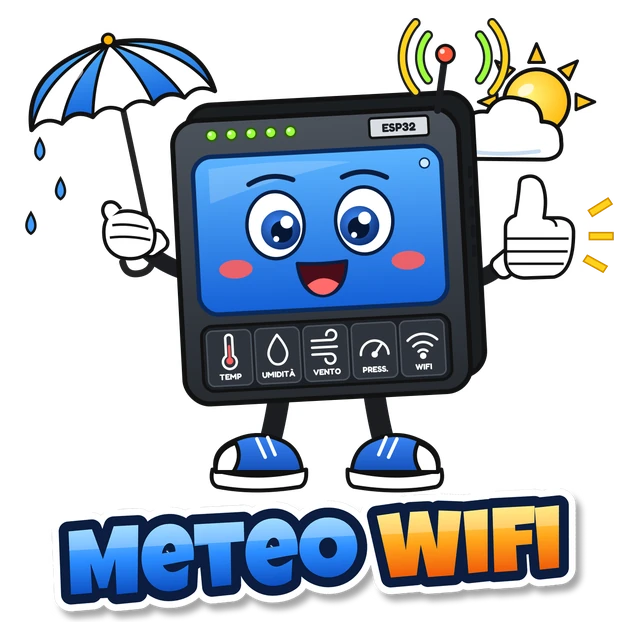
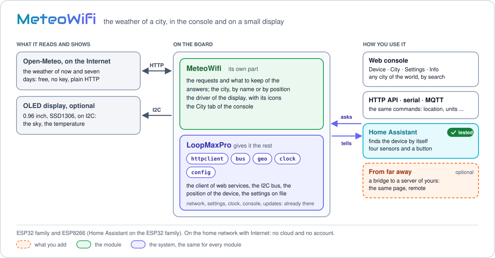
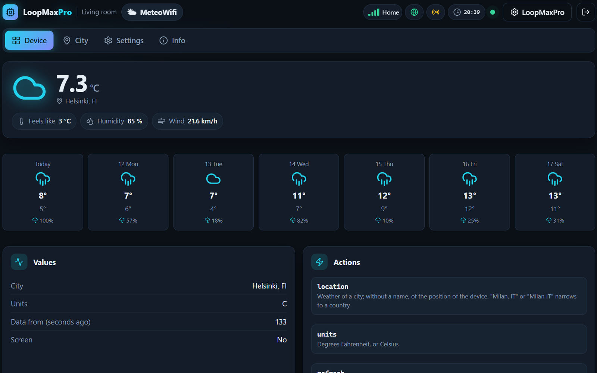

<p align="center"><a href="../../../README.md"></a>&nbsp;&nbsp;&nbsp;</p>

<p align="center"></p>

<p align="center"><em>The weather of a city, in the console and on a small OLED display.</em><br>
A free module for <a href="../../../README.md">LoopMaxPro</a></p>

<p align="center">
<a href="../../../README.md">Home</a> &nbsp;·&nbsp;
<a href="../../../docs/README.md">Documentation</a> &nbsp;·&nbsp;
<a href="../../../README.md#modules">All modules</a> &nbsp;·&nbsp;
<a href="CHANGES.md">Versions</a> &nbsp;·&nbsp;
<a href="https://smartilab.it/firmware/">Web flasher</a>
</p>

---

<h2 id="overview"></h2>

<p align="center">

</p>

MeteoWifi downloads the weather of now and the forecast of seven days from
[Open-Meteo](https://open-meteo.com) and shows them in the console of the device and on the
0.96" OLED display some boards carry, such as the NodeMCU with a display. The place is a city
chosen in the console, or the position of the device.

Open-Meteo is free, wants no key and answers over plain HTTP, so the smallest board, an
ESP8266, reaches it too. The module works on the home network with Internet: no cloud and no
account.

It is also a short example of a module that uses the network and a part mounted on the board.
The system gives the services, the I2C bus and the client of web services; the module owns its
part, the display, with a driver of its own.

| Part | File |
|------|------|
| Manifest: boards, pins, what the module needs | [module.json](module.json) |
| The module: settings, commands, requests, document | [src/meteowifi.cpp](src/meteowifi.cpp) |
| Driver of the display | [src/oled.h](src/oled.h), [src/oled.cpp](src/oled.cpp) |
| Icons and digits of the display | [src/art.h](src/art.h), written by [tools/make_art.py](tools/make_art.py) |
| The City tab of the console | [ui/meteowifi.js](ui/meteowifi.js) |

How a module is made is told in [Writing a module](../../../docs/writing-a-module.md).

<p align="center">
<br>
<em>The page of the module in the web console.</em>
</p>

<h2 id="features"></h2>

- **Now**: sky, temperature, feels like, humidity, wind.
- **Seven days**: sky, highest and lowest temperature, chance of rain.
- **Any city of the world**, chosen from a full list with province, region and country, the
  largest first; or the position of the device, where the board has that service.
- **Celsius or Fahrenheit**, and an update every 5 minutes to 24 hours (15 minutes from the
  factory).
- **On the display**: the sky as a 48 x 48 picture, the temperature in large digits, the
  humidity. Eight skies: clear, clear night, cloudy, fog, rain, rain at night, storm, snow.
- **The display is found by itself** on the boards that carry it on one of two pairs of pins.
- **Home Assistant**: four sensors and a button, on the ESP32 family.

<h2 id="hardware"></h2>

| | |
|---|---|
| Boards | ESP32 family and ESP8266. The suggested one is the NodeMCU V3 with a display, environment `esp8266_nodemcu` |
| Display | SSD1306, 128 x 64, on I2C at address `0x3C`, bus at 400 kHz. Optional: without it the weather is in the console all the same |
| Not supported yet | The 128 x 32 display of the Heltec WiFi Kit 8 |
| Network | A network with Internet |

### Pins

The pins of each board are in `boardPins` of [module.json](module.json); a pin given in the
build wins over them.

| Board | SDA | SCL | Second place: SDA, SCL |
|-------|----:|----:|------------------------|
| ESP8266 | 4 | 5 | none |
| NodeMCU (`esp8266_nodemcu`) | 4 (D2) | 5 (D1) | 14 (D5), 12 (D6) |
| ESP32 family | none | none | none |

On the ESP32 family the module has no pins of its own, so that they stay free for the other
modules: there the display is used only when the build gives its pins (`sda`, `scl`).

NodeMCU V3 boards with a display that look the same carry it on pins 4 and 5, or on 14 and 12.
The module looks in both places.

### How the display is found

At the start the module asks for the display in the first place, up to three times, a second
apart. With no answer it moves the bus to the second place, when the board has one. The place
that answered is kept on file: from the next start the module goes there at once.

Without a display the module works all the same. It says so once in the log
(`no screen at 0x3C`) and leaves the bus free, so that a display can be looked for on other
pins with the commands of the bus service (`i2cOpen`, `i2cScan`).

### What the display shows

```
+------------------------------------------+
|  +--------+        18 °C                 |   digits 28 pixels high
|  |  sky   |                              |
|  | 48x48  |                              |
|  +--------+        drop 80%              |   digits 18 pixels high
+------------------------------------------+
```

The picture is drawn again only when the data change. Icons and digits are in
[src/art.h](src/art.h), written by a script in plain Python, with no libraries. To change
them, edit the script and run it again; `--show` also prints every picture as text.

```
python src/modules/meteowifi/tools/make_art.py --show
```

<h2 id="build-and-flash"></h2>

**Without a build:** the [web flasher](https://smartilab.it/firmware/) of SmartiLab installs a
ready firmware from the browser: choose the firmware and a compatible board. The rest of this
section is for who builds it with PlatformIO.

The modules of a firmware are named in `custom_lmp_modules`. Add an environment of your own to
`platformio.ini`, on top of the one of your board:

```ini
[env:meteowifi_nodemcu]
extends = env:esp8266_nodemcu
custom_lmp_modules = meteowifi
```

```
pio run -e meteowifi_nodemcu -t upload
pio run -e meteowifi_nodemcu -t uploadfs
```

On the ESP8266 the console lives in the filesystem: `uploadfs` writes it. It also replaces
every file of the board, the settings too, so do it at the first installation: after it the
board starts again as an access point. On the ESP32 family the console travels inside the
firmware, and `upload` is all.

A display on other pins, or on an ESP32:

```ini
[env:meteowifi_esp32]
extends = env:esp32dev
custom_lmp_modules = meteowifi:sda=21;scl=22
```

| Parameter | Default | Meaning |
|-----------|---------|---------|
| `sda`, `scl` | -1: the pins of the board | The pins of the display |
| `sda2`, `scl2` | -1: the ones of the board, when it has them | The second place of the display |
| `address` | 60 (`0x3C`) | The I2C address of the display |

The parameters of a module are separated by semicolons, with no spaces: in `platformio.ini` a
semicolon after a space begins a comment. Without touching the files, the same text goes in
the `LMP_MODULES` variable of the shell, which wins over the option:

```
LMP_MODULES="meteowifi:sda=21;scl=22" pio run -e esp32dev -t upload              # Linux, macOS
$env:LMP_MODULES = "meteowifi:sda=21;scl=22"; pio run -e esp32dev -t upload      # Windows PowerShell
```

The module asks the build for the I2C bus and for the client of web services (`requires` in
its manifest). On the ESP8266, where the two are left out to spare memory, they come in only
with a module that asks for them.

A new board starts as the access point `LoopMax-XXXX` (password `loopmaxap`) with the console
on `http://192.168.4.1`. More in [Build and flash](../../../docs/build.md) and
[Boards](../../../docs/boards.md).

<h2 id="using-it"></h2>

Put the device on a network with Internet. The module has four tabs in the console:

| Tab | What it has |
|-----|-------------|
| Device | The weather of now, the seven days, the values of the module, the actions `location`, `units` and `refresh` |
| City | The city of the weather, and the search to change it |
| Settings | The settings below |
| Info | Version, commands and document of the module |

### Choosing the city

With no city chosen the module uses the position of the device. The ESP8266 boards have no
position service: there the Device tab says "no place: choose a city" until one is chosen.

In the **City** tab write a name and search. `Milan, IT` or `Milan IT` narrows the search to a
country. The browser asks the search service of Open-Meteo and shows every city it gives, up
to 100, the largest first, with province, region and country. Tap the right one: the board
gets the name with its coordinates, and has nothing to guess. The name is asked in the
language of the console, in the one of the country written, in the one of the browser and in
English, since the service knows a name only in the language asked.

When the phone or the PC does not reach the service, **Search from the device** lets the board
look for the name itself: it asks in more than one language and takes the most populous city,
where a city with exactly the name asked counts as twenty times its people. The same happens
with the command `location` and with a name written in the City field of the settings. A name
that is not found leaves the city of before.

### How it updates

The weather is asked as soon as Internet is reachable, then every `everyMin` minutes. After a
failed request the module tries again in a minute. `refresh` asks at once, and so does a change
of the settings or of the units.

When something is missing the document has a `problem`, which the Device tab shows:

| `problem` | Meaning |
|-----------|---------|
| `network` | No Internet |
| `place` | No place: choose a city |
| `server` | The service does not answer |
| `answer` | The answer is not valid |

`search` tells how the last search of a city went: `found`, `not-found`, `failed`.

### Settings

| Setting | Values | Default | Meaning |
|---------|--------|---------|---------|
| `api` | address, up to 96 characters | `http://api.open-meteo.com/v1/forecast` | Weather service |
| `geoApi` | address, up to 96 characters | `http://geocoding-api.open-meteo.com/v1/search` | City search service |
| `place` | text, up to 48 characters | empty | City. Empty: the position of the device |
| `lat`, `lon` | -90 to 90, -180 to 180 | 0 | Latitude and longitude of the city |
| `everyMin` | 5 to 1440 | 15 | Update, in minutes |
| `fahrenheit` | true, false | false | Degrees Fahrenheit |
| `screen` | true, false | true where the build gives the pins of a display | The display is on |

### Commands

The target is `mod.meteowifi`. The commands are the same from the console, the serial console
and the HTTP API, and from MQTT where the firmware has it.

| Command | Arguments | What it does |
|---------|-----------|--------------|
| `location` | `name` (optional, up to 48 characters), `lang` (optional, two letters) | The weather of a city; without a name, of the position of the device. The search takes a moment: the outcome arrives later, found or not found |
| `units` | `fahrenheit` (true or false) | Degrees Fahrenheit, or Celsius |
| `refresh` | none | Asks the weather now |

```
cmd mod.meteowifi location name="Milan, IT"
cmd mod.meteowifi units fahrenheit=true
cmd mod.meteowifi refresh
```

The settings are changed with `config.set` (`cmd mod.meteowifi config.set everyMin=30`) and
taken back to the factory ones with `config.reset`. See
[Serial console](../../../docs/serial-console.md) and [HTTP API](../../../docs/http-api.md).

### The document

What the module publishes, for who reads it with a program:

```json
{
  "place": "Milan, IT",
  "units": "C",
  "ageSec": 42,
  "screen": true,
  "now": { "icon": "moon", "value": 17.8, "unit": "°C", "label": "Milan, IT", "code": 0, "sky": "night",
           "items": [ { "key": "feels", "value": 18.4, "unit": "°C", "icon": "thermometer" },
                      { "key": "humidity", "value": 80, "unit": "%", "icon": "droplets" },
                      { "key": "wind", "value": 5.5, "unit": "km/h", "icon": "wind" } ] },
  "days": [ { "date": "2026-01-15", "icon": "cloud", "hi": 9.5, "lo": 2.1, "unit": "°C", "code": 3, "sky": "cloud",
              "items": [ { "key": "rain", "value": 20, "unit": "%", "icon": "umbrella" } ] } ]
}
```

`now` and `days` have the shapes the console draws by itself, with no code of the module.
`code` is the WMO code the service gives; `sky` is one of `sun`, `night`, `cloud`, `fog`,
`rain`, `night_rain`, `storm`, `snow`.

<h2 id="home-assistant"></h2>

With MQTT on and a broker set in the console (MQTT page, "Presents itself to Home Assistant"),
the module tells Home Assistant its things. MQTT is part of the firmware of the ESP32 family,
not of the ESP8266 boards.

| Thing | Kind | Unit |
|-------|------|------|
| `temperature` Temperature | sensor | °C or °F |
| `feels` Feels like | sensor | °C or °F |
| `humidity` Humidity | sensor | % |
| `wind` Wind | sensor | km/h |
| `refresh` Refresh the weather | button | |

More in [Discovery, MQTT and Home Assistant](../../../docs/network-and-home-assistant.md).
