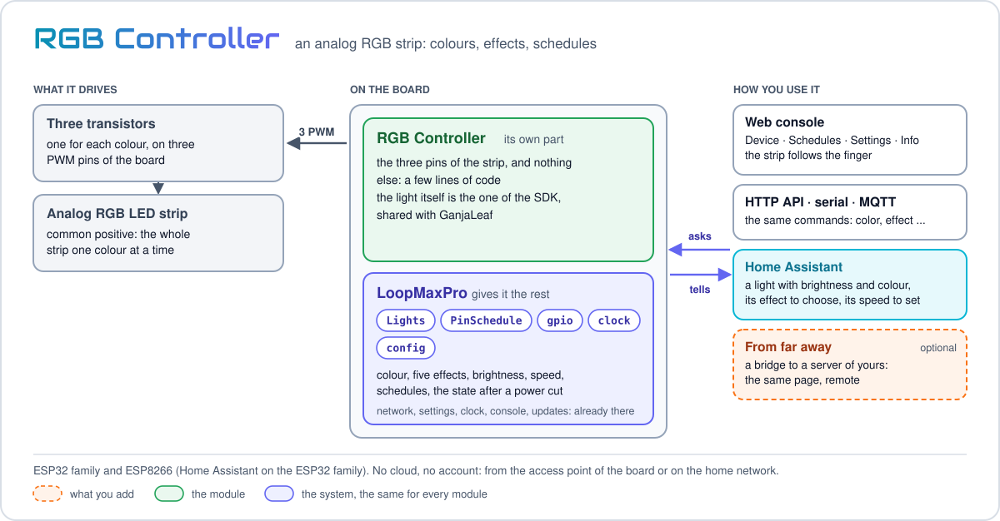
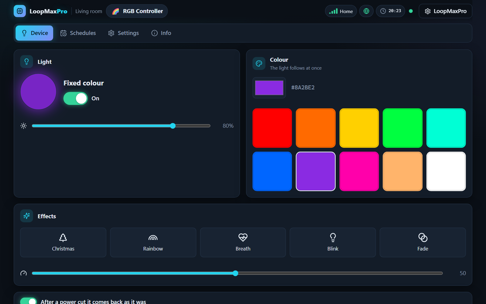
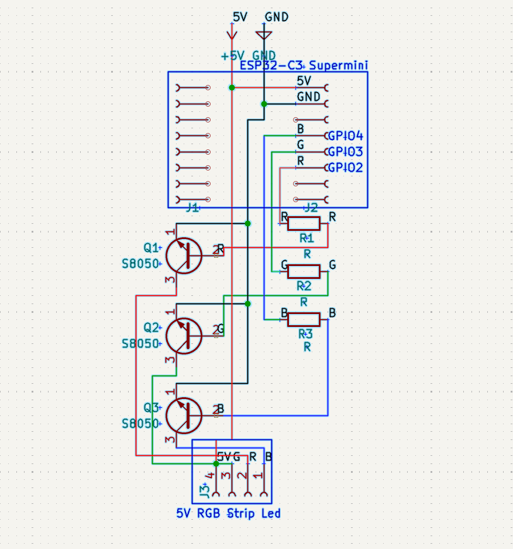
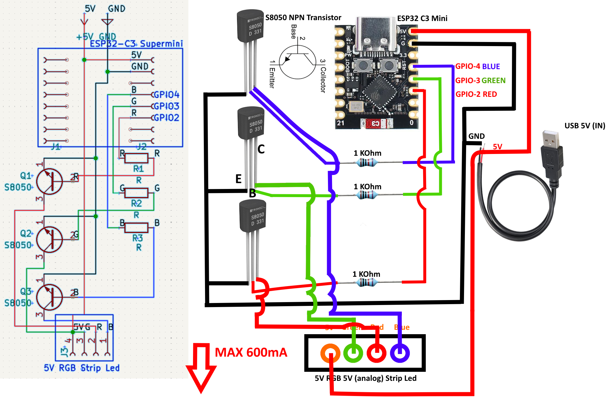

<p align="center"><a href="../../../README.md"></a>&nbsp;&nbsp;&nbsp;</p>

<p align="center"></p>

<p align="center"><em>An analog RGB LED strip with colours, effects, brightness and schedules.</em><br>
A free module for <a href="../../../README.md">LoopMaxPro</a></p>

<p align="center">
<a href="../../../README.md">Home</a> &nbsp;·&nbsp;
<a href="../../../docs/README.md">Documentation</a> &nbsp;·&nbsp;
<a href="../../../README.md#modules">All modules</a> &nbsp;·&nbsp;
<a href="CHANGES.md">Versions</a> &nbsp;·&nbsp;
<a href="https://smartilab.it/firmware/">Web flasher</a>
</p>

---

<h2 id="overview"></h2>

<p align="center">

</p>

RGB Controller drives an analog RGB LED strip, the kind where the whole strip has one colour,
from three PWM pins and three transistors. From the phone you choose a fixed colour or an
effect, the brightness and the speed, turn the strip on and off, and give it schedules. It
works from the access point of the board or on the home network: no cloud and no account.

The module itself is a few lines: the light is the one of the SDK
([src/sdk/lights.h](../../sdk/lights.h)), shared with [GanjaLeaf](../ganjaleaf/README.md), and
the module only gives it the pins ([src/rgb.cpp](src/rgb.cpp)). A good place to start for who
wants to write a module with a light.

<p align="center">
<br>
<em>The page of the module in the web console.</em>
</p>

<h2 id="features"></h2>

- **Fixed colour**, from a colour picker or from ten quick colours: the strip follows while the
  finger moves.
- **Five effects** that run on the board: Christmas, Rainbow, Breath, Blink, Fade.
- **Brightness** from 1 to 100, in steps that look even to the eye, and **speed** of the
  effects from 1 to 100.
- **On and off** that keep the colour or the effect.
- **Schedules**: every week on the days you choose, or once; four of them.
- **After a power cut** the strip comes back as it was, if you want it to.
- **Home Assistant**: the strip is a light with brightness and colour, with its effect to
  choose and the speed of the effect to set, on the ESP32 family.

<h2 id="hardware"></h2>

| | |
|---|---|
| Boards | ESP32 family and ESP8266. The ready-made product is on an ESP32-C3 Supermini |
| Strip | Analog RGB, common positive: one wire for the supply and one for each colour |
| PWM | 10 bits where the chip has them, 8 otherwise; 5000 Hz, changed in the settings |

### Parts

The circuit of the ready-made product, for a 5 V strip fed by the USB supply of the board:

| Part | Pieces |
|------|-------:|
| ESP32-C3 Supermini | 1 |
| S8050 NPN transistor | 3 |
| 1 kΩ resistor | 3 |
| 5 V analog RGB LED strip (5V, G, R, B) | 1 |
| 5 V USB supply | 1 |

### Wiring

Each colour has its transistor on the low side of the strip:

- the pin of the colour goes to the base through a 1 kΩ resistor;
- the emitter goes to GND;
- the collector goes to the wire of that colour of the strip;
- the 5V wire of the strip goes to the 5 V of the supply, together with the 5V pin of the board.

The drawing marks 600 mA as the most the circuit is to carry.

<p align="center">

</p>

<p align="center">

</p>

The design files are for KiCad:
[AnalogRGBController.kicad_sch](docs/AnalogRGBController.kicad_sch),
[AnalogRGBController.kicad_pcb](docs/AnalogRGBController.kicad_pcb),
[AnalogRGBController.kicad_pro](docs/AnalogRGBController.kicad_pro).

### Pins

The pins of each board are in `boardPins` of [module.json](module.json); pins given in the
build win over them.

| Board | Red | Green | Blue |
|-------|----:|------:|-----:|
| Ready-made product `rgb_c3` (ESP32-C3 Supermini) | 2 | 3 | 4 |
| ESP32 | 25 | 26 | 27 |
| ESP32-S2, ESP32-S3, ESP32-C3, ESP32-C6 | 5 | 6 | 7 |
| ESP8266 | 12 (D6) | 13 (D7) | 14 (D5) |

In `rgb_c3` the reset button of LoopMaxPro is the BOOT button of the board, GPIO 9: GPIO 4 is
the blue.

<h2 id="build-and-flash"></h2>

**Without a build:** the [web flasher](https://smartilab.it/firmware/) of SmartiLab installs a
ready firmware from the browser: choose the firmware and a compatible board. The rest of this
section is for who builds it with PlatformIO.

The ready-made product, board and module together, is the environment `rgb_c3` of
[boards/products.ini](../../../boards/products.ini):

```
pio run -e rgb_c3 -t upload
```

For another board add an environment of your own to `platformio.ini`, on top of the one of the
board, and name the module in `custom_lmp_modules`:

```ini
[env:rgb_esp32]
extends = env:esp32dev
custom_lmp_modules = rgb
```

Pins of your own are written red, green, blue, with a vertical bar between them:

```ini
custom_lmp_modules = rgb:pins=16|17|18
```

Without touching the files, the same text goes in the `LMP_MODULES` variable of the shell,
which wins over the option:

```
LMP_MODULES="rgb:pins=16|17|18" pio run -e esp32dev -t upload              # Linux, macOS
$env:LMP_MODULES = "rgb:pins=16|17|18"; pio run -e esp32dev -t upload      # Windows PowerShell
```

On the ESP32 family the console travels inside the firmware: `upload` is all. On the ESP8266
the console lives in the filesystem, so the first installation also wants
`pio run -e <environment> -t uploadfs`, which replaces every file of the board, the settings
too.

A new board starts as the access point `LoopMax-XXXX` (password `loopmaxap`) with the console
on `http://192.168.4.1`. More in [Build and flash](../../../docs/build.md) and
[Boards](../../../docs/boards.md).

<h2 id="using-it"></h2>

The module has four tabs in the console:

| Tab | What it has |
|-----|-------------|
| Device | The light: a preview with its switch and the brightness; the colour picker and ten quick colours; the effects and their speed; the switch "After a power cut it comes back as it was" |
| Schedules | The schedules of the strip |
| Settings | The frequency of the PWM |
| Info | Version, commands and document of the module |

The Device tab is the interface of the lights of the SDK,
[src/sdk/ui/lights.js](../../sdk/ui/lights.js).

### Effects

| Effect | Name | What it does, at speed 50 |
|--------|------|---------------------------|
| Christmas | `christmas` | Red, green, blue, white, off: a step every 1.1 s |
| Rainbow | `rainbow` | Every colour, in a round of 12 s |
| Breath | `breath` | The chosen colour goes up and down, a breath every 2.3 s |
| Blink | `blink` | The chosen colour on and off, twice a second |
| Fade | `fade` | Red, green and blue fading into one another, 0.9 s each passage |

The speed goes from 1, very slow (a rainbow in ten minutes), to 100, fast (a rainbow in six
seconds).

### How it behaves

- A colour stays until an effect is chosen. A colour or an effect turns the strip on.
- The brightness is squared, as the eye sees the light: 50 gives a quarter of the power.
- Turning the strip off keeps colour and effect: turning it on brings them back.
- After a power cut colour, effect, brightness and speed always come back. The strip comes back
  on only if it was on and "After a power cut it comes back as it was" is set, as it is from
  the factory.
- A schedule turns the strip on when its span begins and off when it ends. In between it holds
  the strip: turning it off by hand is refused, and the switch of the console is locked.
- The schedules follow the clock of the device: until the device knows what time it is they
  do nothing.

### Settings

| Setting | Values | Default | Meaning |
|---------|--------|---------|---------|
| `pwmHz` | 100 to 20000 | 5000 | PWM frequency, in Hz. Read when the module starts: after a change, restart the module from the Info tab |

### Commands

The target is `mod.rgb`. The commands of the light take an optional `channel`: the strip is
channel 0, the one used when it is missing.

| Command | Arguments | What it does |
|---------|-----------|--------------|
| `color` | `hex` (`#ff8000` or `ff8000`), or `r`, `g`, `b` (0 to 255) | A fixed colour. Turns the strip on |
| `effect` | `name` | An effect, by the name of the table above. Turns the strip on |
| `brightness` | `value` (1 to 100) | Brightness in percent |
| `speed` | `value` (1 to 100) | Speed of the effects |
| `power` | `value` (true or false) | Turns the strip on or off, with its last colour or effect |
| `set`, `toggle`, `all` | `channel` and `value`; `channel`; `value` | The on and off of every bank of channels of the SDK: here the same as `power` |
| `name` | `channel`, `name` (1 to 24 characters) | Gives the strip a name; it is born as `LED` |
| `restore` | `value` (true or false) | After a power cut the strip comes back as it was, or not |
| `sched.add` | `channel`, `on`, `off`, and optional `type`, `days`, `enabled` | Adds a schedule |
| `sched.update` | `id`, and optional `days`, `on`, `off`, `enabled`, `force` | Changes a schedule |
| `sched.remove` | `id` | Removes a schedule |
| `sched.clear` | `channel` | Removes every schedule |
| `config.set`, `config.reset` | the settings | Change the settings, or take them back to the factory ones |

```
cmd mod.rgb color hex=#ff8000
cmd mod.rgb effect name=rainbow
cmd mod.rgb brightness value=40
cmd mod.rgb power value=false
```

A weekly schedule has `days` as the sum of 1 for Sunday, 2 for Monday, 4 for Tuesday and so on
up to 64 for Saturday (127, every day, when missing), and `on` and `off` as minutes of the
day. This one turns the strip on from 18:30 to 23:00 from Monday to Friday:

```
cmd mod.rgb sched.add channel=0 days=62 on=1110 off=1380
```

With `type=once` the two moments are Unix times in seconds. The commands are the same from
the serial console and the HTTP API, and from MQTT where the firmware has it: see
[Serial console](../../../docs/serial-console.md) and [HTTP API](../../../docs/http-api.md).

<h2 id="home-assistant"></h2>

With MQTT on and a broker set in the console (MQTT page, "Presents itself to Home Assistant"),
the strip appears in Home Assistant as a light, `light0`, with the name of its channel: on and
off, brightness and colour. A colour asked from there ends the effect, as the command does; in
the span of a schedule turning it on or off is refused. MQTT is part of the firmware of the
ESP32 family, not of the ESP8266 boards.

The effect and its speed are there too, to choose and to set:

| Thing | In Home Assistant | |
|-------|-------------------|---|
| `light0` | light | on and off, brightness, colour |
| `effect0` Effect | select | `color` for the fixed colour, `christmas`, `rainbow`, `breath`, `blink`, `fade`. Choosing an effect turns the strip on |
| `speed0` Effect speed | number | from 1 to 100 |

So an automation can do what until now was done only in the console: the rainbow at sunset, a
slow breath at night, the fixed colour again in the morning. A value that is not one of the
six, or a speed out of its limits, is refused by the device.

More in [Discovery, MQTT and Home Assistant](../../../docs/network-and-home-assistant.md).
