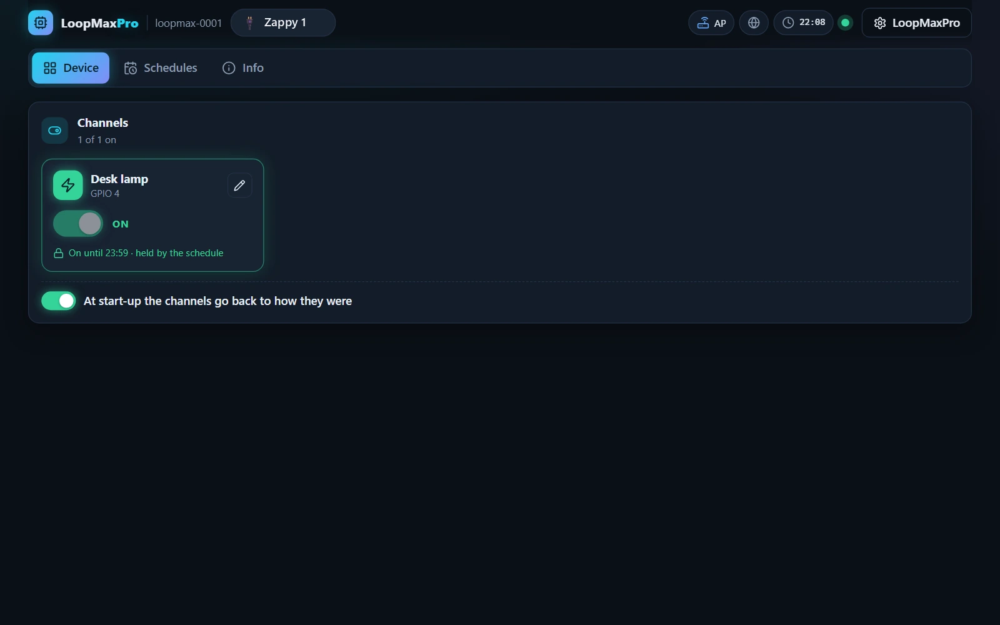

<p align="center"><a href="../../../README.md"></a>&nbsp;&nbsp;&nbsp;</p>

<p align="center"></p>

<p align="center"><em>One relay channel with its own name and schedules.</em><br>
A free module for <a href="../../../README.md">LoopMaxPro</a></p>

<p align="center">
<a href="../../../README.md">Home</a> &nbsp;·&nbsp;
<a href="../../../docs/README.md">Documentation</a> &nbsp;·&nbsp;
<a href="../../../README.md#modules">All modules</a> &nbsp;·&nbsp;
<a href="CHANGES.md">Versions</a> &nbsp;·&nbsp;
<a href="https://smartilab.it/firmware/">Web flasher</a>
</p>

---

<h2 id="overview"></h2>

<p align="center">

</p>

Zappy 1 commands one relay: a socket, a lamp, a pump or a valve. The channel has its own name
and schedules, and is switched on and off from the console, serial console, HTTP API or MQTT.
The module works on its own, from the access point of the board or on the home network: no
cloud and no account.

It has no interface of its own: the console draws it from what the module publishes, its
channel and its schedules. The code is one short file, [src/zappy1ch.cpp](src/zappy1ch.cpp),
made of two parts of the SDK: a bank of pins ([src/sdk/pin_bank.h](../../sdk/pin_bank.h)) and
its schedules ([src/sdk/pin_schedule.h](../../sdk/pin_schedule.h)): a short example of a
hardware module.

<p align="center">
<br>
<em>The page of the module in the web console.</em>
</p>

<h2 id="features"></h2>

- **One channel**, with a name of your own.
- **Schedules**: every week on the days you choose, or once; up to four for the channel.
- **A schedule holds its channel**: while it is on by schedule, a command by hand does not
  turn it off.
- **No collective controls** in the one-channel console: there are no "All on", "All off" or
  "Invert" buttons.
- **After a power cut** the channel goes back to what it was, if you want it to.
- **Relay boards of both kinds**: the channel can be inverted for a board that switches with a
  low pin.
- **Home Assistant**: the channel is an outlet, on the ESP32 family.

<h2 id="hardware"></h2>

| | |
|---|---|
| Boards | ESP32 family and ESP8266. The suggested one is an ESP32, environment `esp32dev` |
| Parts | A relay board with one channel; a supply rated for the board and relay |

### Wiring

| Relay board | Board |
|-------------|-------|
| `IN1` | The pin of the channel |
| `GND` | GND |
| `VCC` | The relay board's rated supply |

Many relay boards switch when their input is low: for those set "Inverted" on the channel, from
the console or with the command `invert`.

A relay that switches mains voltage must be wired by someone qualified to do it safely. Never
connect mains voltage to a GPIO.

### Pins

The pin of each board is in `boardPins` of [module.json](module.json); a pin given in the build
wins over it.

| Board | Channel 1 |
|-------|----------:|
| ESP32 | 22 |
| ESP32-S2, ESP32-S3, ESP32-C3, ESP32-C6 | 5 |
| ESP8266 | 12 (D6) |

<h2 id="build-and-flash"></h2>

**Without a build:** the [web flasher](https://smartilab.it/firmware/) of SmartiLab installs a
ready firmware from the browser: choose Zappy 1 and a compatible board. The rest of this
section is for who builds it with PlatformIO.

The modules of a firmware are named in `custom_lmp_modules`. Add an environment of your own to
`platformio.ini`, on top of the one of your board:

```ini
[env:zappy1_esp32]
extends = env:esp32dev
custom_lmp_modules = zappy1ch
```

```text
pio run -e zappy1_esp32 -t upload
```

To choose a different pin:

```ini
custom_lmp_modules = zappy1ch:pins=16
```

Without touching the files, the same text goes in the `LMP_MODULES` variable of the shell,
which wins over the option:

```text
LMP_MODULES="zappy1ch:pins=16" pio run -e esp32dev -t upload
$env:LMP_MODULES = "zappy1ch:pins=16"; pio run -e esp32dev -t upload
```

On the ESP32 family the console travels inside the firmware: `upload` is all. On the ESP8266
the console lives in the filesystem, so the first installation also wants
`pio run -e <environment> -t uploadfs`, which replaces every file of the board, the settings
too.

A new board starts as the access point `LoopMax-XXXX` (password `loopmaxap`) with the console
on `http://192.168.4.1`. More in [Build and flash](../../../docs/build.md) and
[Boards](../../../docs/boards.md).

<h2 id="using-it"></h2>

The module has three tabs in the console, all drawn by the console itself:

| Tab | What it has |
|-----|-------------|
| Device | The one channel and its switch; the pencil of the channel, for its name and "Inverted"; the switch "At start-up the channel goes back to how it was" |
| Schedules | The schedule of the channel: add, change, enable, remove |
| Info | Version, commands and document of the module |

### How it behaves

- The channel is born as `Line 1`. In commands it is channel 0.
- At the start the channel goes back to what it was, when `restore` is on, as it is from the
  factory. With `restore` off every start finds it off.
- A schedule turns the channel on when its span begins and off when it ends. In between it
  holds the channel: `set` and `toggle` answer `denied`, `all` and `flip` pass it over, and its
  switch in the console is locked. Out of the span the channel is free.
- The schedules follow the clock of the device, not Internet: a device that knows what time it
  is follows them also on a network that goes nowhere. Until it knows, they do nothing.
- Two enabled schedules of the channel never share time. A new one that would is saved
  disabled, and the answer says with which it shares; enabling it is refused with `busy`,
  unless `force` is given: then the others are disabled.
- There are no "All on", "All off" or "Invert" buttons in the console: with one channel the
  collective controls are not shown.

### Commands

The target is `mod.zappy1ch`.

| Command | Arguments | What it does |
|---------|-----------|--------------|
| `set` | `channel` (0), `value` (true or false) | Turns the channel on or off |
| `toggle` | `channel` (0) | Turns the channel into the opposite of what it is |
| `all` | `value` (true or false) | Turns the channel on or off, except when a schedule holds it |
| `flip` | none | Turns the channel into the opposite of what it is, except when a schedule holds it |
| `name` | `channel` (0), `name` (1 to 24 characters) | Gives a name to the channel |
| `invert` | `channel` (0), `value` (true or false) | A channel that is on keeps its pin low |
| `restore` | `value` (true or false) | At the next start the channel goes back to what it was, or not |
| `sched.add` | `channel`, `on`, `off`, and optional `type`, `days`, `enabled` | Adds a schedule. The answer has its `id`, whether it is `enabled`, and the `conflicts` |
| `sched.update` | `id`, and optional `days`, `on`, `off`, `enabled`, `force` | Changes days, times or state of a schedule |
| `sched.remove` | `id` | Removes a schedule |
| `sched.clear` | `channel` | Removes every schedule of the channel |

```text
cmd mod.zappy1ch set channel=0 value=true
cmd mod.zappy1ch name channel=0 name="Desk lamp"
cmd mod.zappy1ch all value=false
```

The commands are the same from the serial console and the HTTP API, and from MQTT where the
firmware has it: see [Serial console](../../../docs/serial-console.md) and
[HTTP API](../../../docs/http-api.md).

### Schedules

| Argument | Weekly (`type=weekly`, the one used when `type` is missing) | Once (`type=once`) |
|----------|--------------------------------------------------------------|--------------------|
| `days` | The sum of 1 for Sunday, 2 for Monday, 4 for Tuesday and so on up to 64 for Saturday. 127, every day, when missing | Not used |
| `on` | The minute of the day the channel turns on, 0 to 1439 | The moment it turns on, as Unix time in seconds |
| `off` | The minute it turns off. Before `on`: the day after | The moment it turns off |

Channel 0 on from 08:00 to 18:00 from Monday to Friday:

```text
cmd mod.zappy1ch sched.add channel=0 days=62 on=480 off=1080
```

A schedule that happens once is removed by itself when it is over.

<h2 id="home-assistant"></h2>

With MQTT on and a broker set in the console (MQTT page, "Presents itself to Home Assistant"),
the channel appears in Home Assistant as a switch, `ch0`, with the name you gave it. It is
told as an outlet, so Home Assistant and the voice assistants behind it take it for a socket
and not a plain switch. A schedule holding the channel refuses a command from there too. MQTT
is part of the firmware of the ESP32 family, not of the ESP8266 boards.

| Thing | In Home Assistant |
|-------|-------------------|
| `ch0` | switch, class `outlet`; on and off, with the name of the channel |

More in [Discovery, MQTT and Home Assistant](../../../docs/network-and-home-assistant.md).

<h2 id="license"></h2>

Zappy 1 is part of LoopMaxPro and is available under the project's
[license](../../../LICENSE).
