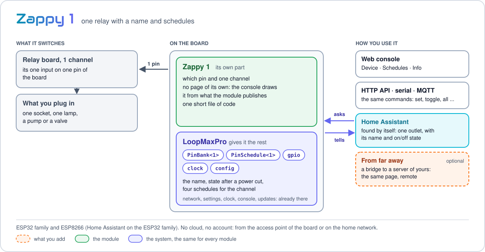

<p align="center"><a href="../../../README.md"></a>&nbsp;&nbsp;&nbsp;</p>

<p align="center"><em>One relay channel with a name and schedules.</em><br>
A free module for <a href="../../../README.md">LoopMaxPro</a></p>

<p align="center">
<a href="../../../README.md">Home</a> &nbsp;·&nbsp;
<a href="../../../docs/README.md">Documentation</a> &nbsp;·&nbsp;
<a href="../../../README.md#modules">All modules</a> &nbsp;·&nbsp;
<a href="CHANGES.md">Versions</a> &nbsp;·&nbsp;
<a href="https://smartilab.it/firmware/">Web flasher</a>
</p>

---

<h2 id="overview"></h2>

<p align="center">

</p>

<p align="center">
<br>
<em>The single-channel page in the web console; there are no all-channel controls.</em>
</p>

Zappy 1CH controls one relay: a socket, a lamp, a pump or a valve. It has a name and schedules,
and can be operated from the console, serial console, HTTP or MQTT. It works on its own, from
the board's access point or the home network: no cloud or account is needed.

The module uses the standard console view; there are no multi-channel actions for a single
channel and no custom UI file. Its code is the same [PinBank](../../sdk/pin_bank.h) and
[PinSchedule](../../sdk/pin_schedule.h) SDK used by [Zappy 2](../zappy2/README.md).

<h2 id="features"></h2>

- **One channel**, with a name of your own.
- **Schedules**: weekly on selected days or one-time; up to four.
- **A schedule holds the channel**: while it is on by schedule, a manual command does not turn it off.
- **Restore after a power cut**, when enabled.
- **Relay boards of either polarity**: invert the channel for boards that switch on a low pin.
- **Home Assistant**: the channel is an outlet on the ESP32 family.
- **No cloud required**. The module works locally and can be combined with a bridge in a
  separately configured firmware.

<h2 id="hardware"></h2>

| | |
|---|---|
| Boards | ESP32 family and ESP8266; suggested board: ESP32 WROOM-32, environment `esp32dev` |
| Parts | A one-channel relay board and its appropriate power supply |

### Wiring

| Relay board | Board |
|-------------|-------|
| `IN1` | GPIO22 on the suggested ESP32 board |
| `GND` | GND |
| `VCC` | The relay board's rated supply |

The default pin varies by board; see `boardPins` in [module.json](module.json). Pins supplied
in the build take precedence. Check that the selected GPIO is available on the specific board.
Some relay boards switch when their input is low; set **Inverted** in the console for those.

Mains voltage is dangerous. Have relay wiring and mains connections installed and checked by
someone qualified; never connect mains to a GPIO.

### Pins

| Board | Default pin |
|-------|------------:|
| ESP32 | 22 |
| ESP32-S2, ESP32-S3, ESP32-C3, ESP32-C6 | 5 |
| ESP8266 | 12 (D6) |

<h2 id="build-and-flash"></h2>

**Without a build:** choose Zappy 1CH and a compatible board in the
[web flasher](https://smartilab.it/firmware/). The rest of this section is for PlatformIO.

Add an environment for your board in `platformio.ini`:

```ini
[env:zappy1ch_esp32]
extends = env:esp32dev
custom_lmp_modules = zappy1ch
```

```text
pio run -e zappy1ch_esp32 -t upload
```

To choose a different pin:

```ini
custom_lmp_modules = zappy1ch:pins=16
```

Or, without changing project files:

```text
LMP_MODULES="zappy1ch:pins=16" pio run -e esp32dev
```

On PowerShell:

```powershell
$env:LMP_MODULES = "zappy1ch:pins=16"
pio run -e esp32dev
Remove-Item Env:LMP_MODULES
```

This module works locally without a bridge.

<h2 id="license"></h2>

Zappy 1CH is part of LoopMaxPro and is available under the project's
[license](../../../LICENSE).
