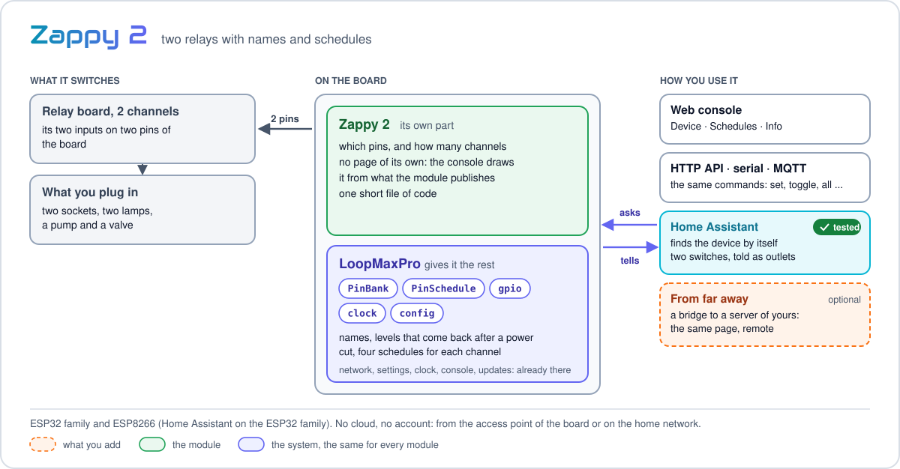
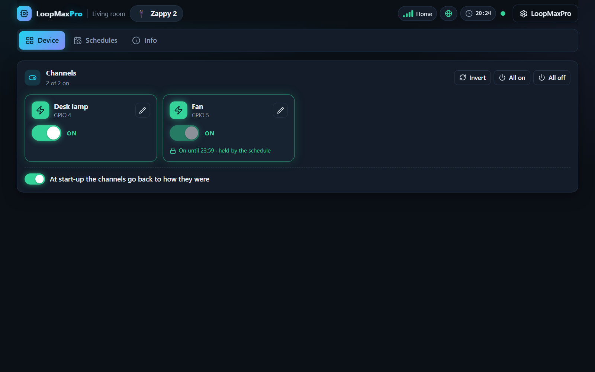
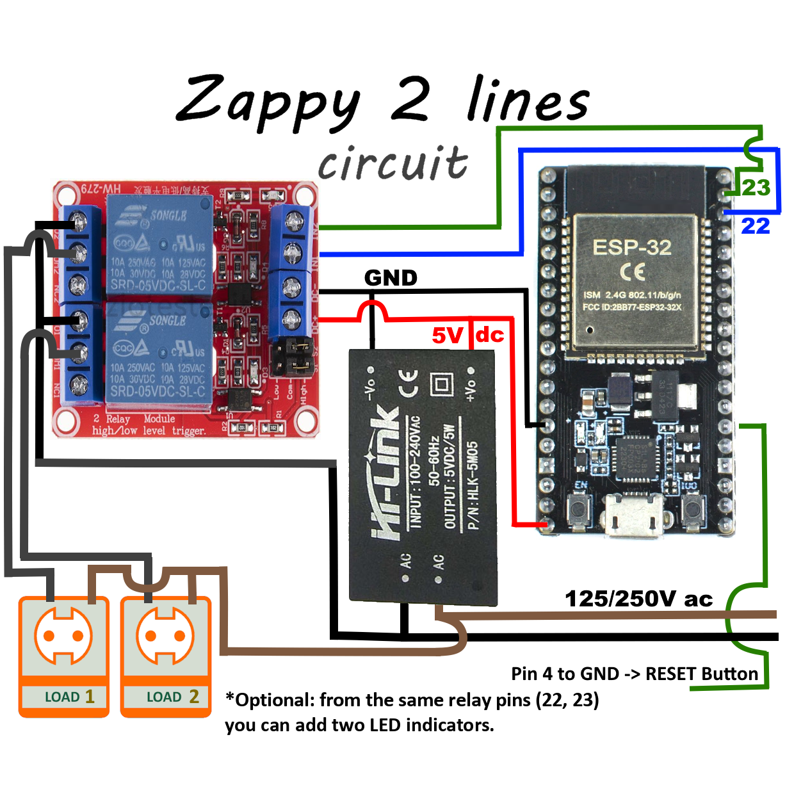

<p align="center"><a href="../../../README.md"></a>&nbsp;&nbsp;&nbsp;</p>

<p align="center"></p>

<p align="center"><em>Two relay channels with names and schedules.</em><br>
A free module for <a href="../../../README.md">LoopMaxPro</a></p>

<p align="center">
<a href="../../../README.md">Home</a> &nbsp;·&nbsp;
<a href="../../../docs/README.md">Documentation</a> &nbsp;·&nbsp;
<a href="../../../README.md#modules">All modules</a> &nbsp;·&nbsp;
<a href="CHANGES.md">Versions</a> &nbsp;·&nbsp;
<a href="https://smartilab.it/firmware/">Web flasher</a>
</p>

---

<h2 id="overview"></h2>

<p align="center">

</p>

Zappy 2 commands two relays: two sockets, two lamps, a pump and a valve. Each channel has its
name and its schedules, and is turned on and off from the console, from the serial console,
over HTTP or MQTT. The module works on its own, from the access point of the board or on the
home network: no cloud and no account.

It has no interface of its own: the console draws it from what the module publishes, its
channels and its schedules. The code is one short file, [src/zappy2.cpp](src/zappy2.cpp), made
of two parts of the SDK: a bank of pins ([src/sdk/pin_bank.h](../../sdk/pin_bank.h)) and its
schedules ([src/sdk/pin_schedule.h](../../sdk/pin_schedule.h)): a short example of a hardware
module.

<p align="center">
<br>
<em>The page of the module in the web console.</em>
</p>

<h2 id="features"></h2>

- **Two channels**, each with a name of your own.
- **Schedules**: every week on the days you choose, or once; four for each channel.
- **A schedule holds its channel**: while it is on by schedule, a command by hand does not
  turn it off.
- **All on, all off, invert all**, with one key.
- **After a power cut** the channels go back to what they were, if you want them to.
- **Relay boards of both kinds**: a channel can be inverted for the boards that switch with a
  low pin.
- **Home Assistant**: the two channels are outlets, on the ESP32 family.

<h2 id="hardware"></h2>

| | |
|---|---|
| Boards | ESP32 family and ESP8266. The suggested one is an ESP32, environment `esp32dev` |
| Parts | A relay board with two channels; a 5 V supply |

### Wiring

| Relay board | Board |
|-------------|-------|
| `IN1` | The pin of channel 1 |
| `IN2` | The pin of channel 2 |
| `GND` | GND |
| `VCC` | 5 V, when the relay board wants it |

Many relay boards switch when their input is low: for those set "Inverted" on both channels,
from the console or with the command `invert`.

A relay that switches mains voltage is to be wired by who knows how to do it safely.

The drawing shows the circuit on an ESP32 board: the two inputs of the relay board on GPIO 22
and 23, a small mains to 5 V supply for the board and the relays, the two loads on the relay
contacts, and the reset button of LoopMaxPro between GPIO 4 and GND.

<p align="center">

</p>

### Pins

The pins of each board are in `boardPins` of [module.json](module.json); pins given in the
build win over them.

| Board | Channel 1 | Channel 2 |
|-------|----------:|----------:|
| ESP32 | 22 | 23 |
| ESP32-S2, ESP32-S3, ESP32-C3, ESP32-C6 | 5 | 6 |
| ESP8266 | 12 (D6) | 13 (D7) |

<h2 id="build-and-flash"></h2>

**Without a build:** the [web flasher](https://smartilab.it/firmware/) of SmartiLab installs a
ready firmware from the browser: choose the firmware and a compatible board. The rest of this
section is for who builds it with PlatformIO.

The modules of a firmware are named in `custom_lmp_modules`. Add an environment of your own to
`platformio.ini`, on top of the one of your board:

```ini
[env:zappy2_esp32]
extends = env:esp32dev
custom_lmp_modules = zappy2
```

```
pio run -e zappy2_esp32 -t upload
```

Pins of your own are written with a vertical bar between them:

```ini
custom_lmp_modules = zappy2:pins=16|17
```

Without touching the files, the same text goes in the `LMP_MODULES` variable of the shell,
which wins over the option:

```
LMP_MODULES="zappy2:pins=16|17" pio run -e esp32dev -t upload              # Linux, macOS
$env:LMP_MODULES = "zappy2:pins=16|17"; pio run -e esp32dev -t upload      # Windows PowerShell
```

On the ESP32 family the console travels inside the firmware: `upload` is all. On the ESP8266
the console lives in the filesystem, so the first installation also wants
`pio run -e <environment> -t uploadfs`, which replaces every file of the board, the settings
too.

A new board starts as the access point `LoopMax-XXXX` (password `loopmaxap`) with the console
on `http://192.168.4.1`. More in [Build and flash](../../../docs/build.md) and
[Boards](../../../docs/boards.md).

<h2 id="using-it"></h2>

The module has three tabs in the console, all drawn by the console itself:

| Tab | What it has |
|-----|-------------|
| Device | The two channels with their switches; "All on", "All off" and "Invert"; the pencil of a channel, for its name and for "Inverted"; the switch "At start-up the channels go back to how they were" |
| Schedules | The schedules of each channel: add, change, enable, remove |
| Info | Version, commands and document of the module |

### How it behaves

- The channels are born as `Line 1` and `Line 2`. In the commands they are channel 0 and
  channel 1.
- At the start the channels go back to what they were, when `restore` is on, as it is from the
  factory. With `restore` off every start finds them off.
- A schedule turns its channel on when its span begins and off when it ends. In between it
  holds the channel: `set` and `toggle` answer `denied`, `all` and `flip` pass it over, and its
  switch in the console is locked. Out of the span the channel is free.
- The schedules follow the clock of the device, not Internet: a device that knows what time it
  is follows them also on a network that goes nowhere. Until it knows, they do nothing.
- Two enabled schedules of a channel never share time. A new one that would is saved disabled,
  and the answer says with which it shares; enabling it is refused with `busy`, unless `force`
  is given: then the others are disabled.

### Commands

The target is `mod.zappy2`.

| Command | Arguments | What it does |
|---------|-----------|--------------|
| `set` | `channel` (0 or 1), `value` (true or false) | Turns a channel on or off |
| `toggle` | `channel` | Turns a channel into the opposite of what it is |
| `all` | `value` (true or false) | Turns every channel on or off, except those a schedule holds |
| `flip` | none | Every channel into the opposite, except those a schedule holds |
| `name` | `channel`, `name` (1 to 24 characters) | Gives a name to a channel |
| `invert` | `channel`, `value` (true or false) | A channel that is on keeps its pin low |
| `restore` | `value` (true or false) | At the next start the channels go back to what they were, or not |
| `sched.add` | `channel`, `on`, `off`, and optional `type`, `days`, `enabled` | Adds a schedule. The answer has its `id`, whether it is `enabled`, and the `conflicts` |
| `sched.update` | `id`, and optional `days`, `on`, `off`, `enabled`, `force` | Changes days, times or state of a schedule |
| `sched.remove` | `id` | Removes a schedule |
| `sched.clear` | `channel` | Removes every schedule of a channel |

```
cmd mod.zappy2 set channel=0 value=true
cmd mod.zappy2 name channel=1 name="Garden pump"
cmd mod.zappy2 all value=false
```

The commands are the same from the serial console and the HTTP API, and from MQTT where the
firmware has it: see [Serial console](../../../docs/serial-console.md) and
[HTTP API](../../../docs/http-api.md).

### Schedules

| Argument | Weekly (`type=weekly`, the one used when `type` is missing) | Once (`type=once`) |
|----------|--------------------------------------------------------------|--------------------|
| `days` | The sum of 1 for Sunday, 2 for Monday, 4 for Tuesday and so on up to 64 for Saturday. 127, every day, when missing | Not used |
| `on` | The minute of the day the channel turns on, 0 to 1439 | The moment it turns on, as Unix time in seconds |
| `off` | The minute it turns off. Before `on`: the day after | The moment it turns off |

Channel 0 on from 08:00 to 18:00 from Monday to Friday, and channel 1 on every night from
22:30 to 06:00:

```
cmd mod.zappy2 sched.add channel=0 days=62 on=480 off=1080
cmd mod.zappy2 sched.add channel=1 on=1350 off=360
```

A schedule that happens once is removed by itself when it is over.

<h2 id="home-assistant"></h2>

With MQTT on and a broker set in the console (MQTT page, "Presents itself to Home Assistant"),
the two channels appear in Home Assistant as switches, `ch0` and `ch1`, with the names you gave
them. They are told as outlets, so that Home Assistant, and the voice assistants behind it,
take them for sockets and not for plain switches. A channel a schedule holds refuses a command
from there too. MQTT is part of the firmware of the ESP32 family, not of the ESP8266 boards.

More in [Discovery, MQTT and Home Assistant](../../../docs/network-and-home-assistant.md).
